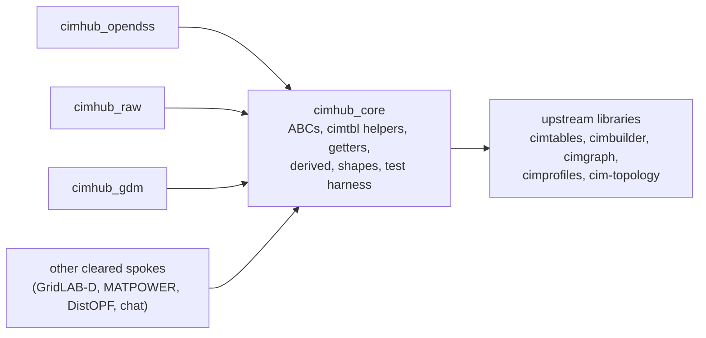
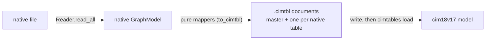
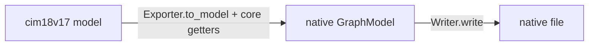

# CIMHub architecture

CIMHub converts native power-system formats to and from CIM. It targets one CIM profile, **cim18v17**.
This page explains how the pieces fit. It is for contributors; the rules Claude follows while coding are in
[`.claude/skills/`](../../.claude/skills/), and each section links the one that applies.

Related docs: [CONVERTER_API.md](CONVERTER_API.md) (the public functions), [TESTING.md](TESTING.md) (test tiers),
[UNITS.md](UNITS.md) (units on import and export).

## Hub and spoke

`cimhub_core` is the hub. Each native format is a spoke, a package of its own that depends on core and never the
other way round.



Core is thin on purpose. It holds only what no upstream library provides (invariant I9, below). A spoke adds the
format-specific parts: a native schema, a reader and writer, the mappers (import) and the exporter modules.

## Import flow

An import never builds CIM objects in spoke code. The spoke maps native records to `.cimtbl` text, and
[cimtables](https://pypi.org/project/cim-tables/) binds that text into a cim18v17 model.



| Step | Who | Notes |
|---|---|---|
| `Reader.read_all()` | the spoke | The only step that reads the file. Returns a core `GraphModel` of native LinkML dataclasses. |
| `to_cimtbl(model)` | the spoke | Pure: native objects in, `cimtables.document` documents out. Values are copied verbatim, with the source unit in the column header. |
| `cimtbl_to_cim(...)` | core | Writes the documents, then builds CIM from the written text. With `artifact_dir` the files are kept as an audit artifact; without it they go to a temporary directory. |

`CimtblImporter.to_cim` runs the last two steps. The master document declares `Profile = cim18v17` and `Import`s
one part per native table, catalogs first. An excerpt of the master from the `codes` atom of the OpenDSS tests (some statements left out):

```
Profile = cim18v17
Authority = https://github.com/PNNL-CIM-Tools/CIMHub
Model = codes

Object Substation: mRID=sub_atom, name=atom
Table BaseVoltage: mRID, nominalVoltage (kV)
    bv_4p16kv, 4.16

Import bus.cimtbl
Import linecode.cimtbl
Import line.cimtbl
```

A part that needs the Terminals binding creates (OpenDSS bus coordinates) is mapped after binding, through
`CimtblImporter.bound_parts`, and imported last. Rules: skills
[`cimtbl-import-contract`](../../.claude/skills/cimtbl-import-contract/SKILL.md),
[`cimtbl-shapes`](../../.claude/skills/cimtbl-shapes/SKILL.md) and
[`conductor-geometry`](../../.claude/skills/conductor-geometry/SKILL.md).

### Exception: GDM is builder-native

GDM objects are already typed components, not records of a text file. `cimhub_gdm` therefore skips `.cimtbl` and
calls CIM-Builder's keyword builders directly (`GdmImporter` subclasses `FormatImporter`, not `CimtblImporter`).
It still takes a parsed model in and returns a cim18v17 `FeederModel`, and it still classifies every GDM class
and fails on one it does not know. See [`cimhub_gdm/docs/GDM_MAPPING.md`](../../cimhub_gdm/docs/GDM_MAPPING.md).

## Export flow

Exporters read CIM through the core getters and return a native model. A writer turns that into a file.



Getters (`cimhub_core.getters`) return plain floats in the caller's unit, using `cimtables.graph_write.get_qty` for
every conversion, so exporters never multiply by `1e3`. The exporter returns the same model shape the reader
returns, so a round trip is `read_all` -> import -> export -> `write`. Skill:
[`export-getters`](../../.claude/skills/export-getters/SKILL.md).

A worked round trip with the OpenDSS spoke, run from the repo root:

```python
from cimhub_opendss import DssExporter, DssImporter, DssReader, DssWriter

native = DssReader("cimhub_opendss/tests/atoms/line/codes.dss").read_all()
importer = DssImporter(name="codes")
documents = importer.to_cimtbl(native)                      # master + parts, nothing written yet
network = importer.to_cim(native, artifact_dir="out/codes")  # writes out/codes/*.cimtbl, then binds them
DssWriter().write(DssExporter().to_model(network), "out/back.dss")
```

`dss_to_cim(model, name=...)` and `cim_to_dss(network, path)` are the one-call forms. The public API is in
[CONVERTER_API.md](CONVERTER_API.md). The tests that load `.cimtbl` wrap themselves in
`cimhub_core.cimtbl_testing.cim_scope()`, because cimtables sets the profile and model scope process-wide.

## What core holds

Everything is under `cimhub_core/src/cimhub_core/`.

| Module | Holds |
|---|---|
| `base.py` | The ABCs: `FormatReader`, `FormatWriter`, `FormatImporter`, `CimtblImporter`, `FormatExporter`. Objects in, objects out; only readers and writers touch the filesystem. |
| `cimtbl.py` | Import helpers: `cell`, `mrid`, `lookup`, `Field` and `copied_columns`, `check_fields`, `fields_table`, `cimtbl_to_cim`. |
| `cimtbl_testing.py` | Atom-test harness: `cim_scope`, `atom_documents`, `assert_matches_golden` (set `CIMHUB_UPDATE_GOLDENS=1` to regenerate; review the diff), `record_diff`. |
| `getters/` | One module per CIM concept (terminals, line impedance, spacing, transformer, shunt, tap changer, limits, DER, and more). Cim18v17 only. |
| `derived/` | Pure, named, tested functions for values CIM has no attribute for (Kron reduction, capacitance to susceptance, sequence to phase matrix, spacing from distances, control band, regulator settings). |
| `shapes/` | Canonical `.cimtbl` table shapes, one example file per shape. Catalog: skill [`cimtbl-shapes`](../../.claude/skills/cimtbl-shapes/SKILL.md). |
| `graph_model.py` | `GraphModel`, the indexed store for native dataclasses (`list_by_class`, `find_by_attribute`). |
| `serialization.py` | `AnnotationSerializer`: native text formatting driven by LinkML annotations. |
| `names.py`, `registry.py`, `load_response.py` | Export-side naming, the class-to-function `ConverterRegistry`, and the shared `zip_fractions.cimtbl`. |
| `mermaid.py`, `scaffold.py` | Diagrams of native dataclasses, and `scaffold_package` for a new spoke. |

Core has no code-table module yet. A native-code-to-CIM-enum table stays in the spoke and is applied with
`cimtbl.lookup`, which raises on an unmapped value. It moves into core once a second spoke needs the same table.

## What upstream owns

| Library (import name) | Owns |
|---|---|
| cim-tables (`cimtables`) | The `.cimtbl` format, parser, `load_model`, `get_qty`, unit and base-value conversion, `impedance.z_base`. |
| cim-builder (`cimbuilder`) | Keyword builders that construct CIM objects. GDM uses them directly. |
| cim-graph (`cimgraph`) | The CIM graph model classes and database connections. |
| cim-profiles (`cimprofiles`) | The cim18v17 profile classes, enums and units. |
| cim-topology (`cimtopology`) | Spanning trees, islands, voltage zones, BaseVoltage walk. A spoke builds a `Network` from native records and never writes its own graph walk. |

Open asks to these libraries are in [`.development/UPSTREAM_REQUESTS.md`](../../.development/UPSTREAM_REQUESTS.md).

## Invariants

Every change is checked against these. The full text is in [`CLAUDE.md`](../../CLAUDE.md).

| # | Rule | Why |
|---|---|---|
| I1 | The `.cimtbl` artifact is the only input to CIM. | What a reviewer reads is exactly what was built. |
| I2 | Values are copied verbatim, in source units, with the unit in the column header. | Unit math lives in one place (cimtables), not in every spoke. |
| I3 | Every field of a mapped native class is classified: copied, mapped, structural, derived or untranscribed. | A test checks the classification covers every slot, so nothing is dropped silently. |
| I4 | One artifact file per native table; the master imports them in dependency order. | Artifacts line up with the native source and catalogs bind before their users. |
| I5 | Spokes never construct CIM objects. | Construction rules (terminals, bases) stay in one place. |
| I6 | CIM 18 templates, never `*Info` catalogs. | cim18v17 removed the `*Info` classes. |
| I7 | Mappers are pure; only readers and writers touch the filesystem. | Each stage can be tested and inspected alone. |
| I8 | Fail fast: unknown fields, unmapped enums and unresolved references raise. IDs are quoted, never sanitized. | A bad input stops at its cause, and identity survives a round trip. |
| I9 | Upstream first. | A local stand-in drifts from the library that should own the capability. |

## Spoke package layout

```
cimhub_<fmt>/
  src/cimhub_<fmt>/
    schema/                       native LinkML schema + generated dataclasses
    <fmt>_reader.py               FormatReader
    <fmt>_writer.py               FormatWriter
    importer/
      <fmt>_to_cimtbl.py          orchestrator: master, mapping order, <fmt>_to_cim
      cimtbl/<native_table>.py    one pure mapper per native table, with its FIELDS classification
    exporter/
      cim_to_<fmt>.py             orchestrator: module order, cim_to_<fmt>
      <concept>.py                one module per CIM concept, built on the core getters
  tests/
    atoms/<native_table>/         minimal native file + reviewed golden .cimtbl
  docs/CIMTBL_MAPPING.md          the spoke's import spec
```

Exact file names vary by format (RAW uses `raw34_reader.py`; GDM has no `importer/cimtbl/`). Skills:
[`reader-writer`](../../.claude/skills/reader-writer/SKILL.md),
[`linkml-native-schema`](../../.claude/skills/linkml-native-schema/SKILL.md),
[`atom-tests`](../../.claude/skills/atom-tests/SKILL.md).

## Where each spoke's specs live

| Spoke | Specs |
|---|---|
| OpenDSS | [`CIMTBL_MAPPING.md`](../../cimhub_opendss/docs/CIMTBL_MAPPING.md) (import), [`EXPORT_MAPPING.md`](../../cimhub_opendss/docs/EXPORT_MAPPING.md) (export) |
| RAW | [`CIMTBL_MAPPING.md`](../../cimhub_raw/docs/CIMTBL_MAPPING.md) |
| GDM | [`cimhub_gdm/docs/`](../../cimhub_gdm/docs/): `GDM_MAPPING.md`, `EXPORT_MAPPING.md` and the wave plans |

How to write a spec: skill [`cimtbl-mapping-spec`](../../.claude/skills/cimtbl-mapping-spec/SKILL.md). Which files are
safe to publish: skill [`split-readiness`](../../.claude/skills/split-readiness/SKILL.md).
