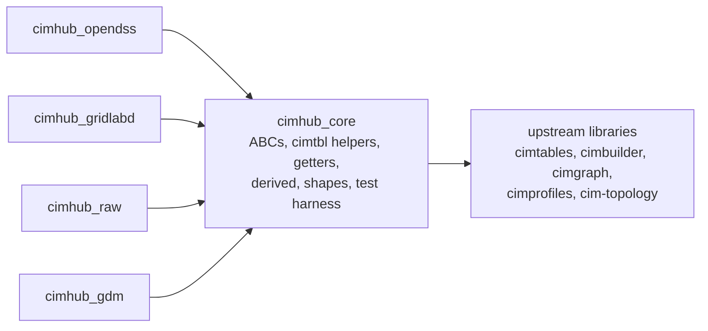
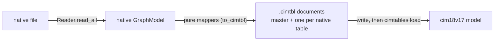
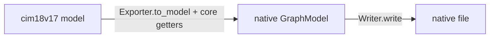

# CIMHub architecture

CIMHub converts native power-system formats to and from CIM. It targets one CIM profile, **cim18v17**.
This page explains how the pieces fit. It is for contributors; the rules for writing each part are in the
repository's
[skills](https://github.com/PNNL-CIM-Tools/CIMHub/tree/develop/.claude/skills), and each section links the one that
applies.

Related pages: [Converter API](converter-api.md) (the public classes and functions), [Testing](testing.md) (test
types), [Units](units.md) (units on import and export).

## Hub and spoke

`cimhub_core` is the hub. Each native format is a spoke, a package of its own that depends on core and never the
other way round.



| Package | Native format | Import | Export |
|---|---|---|---|
| `cimhub_opendss` | OpenDSS `.dss` | `.dss` to `.cimtbl` to CIM | CIM to `.dss` |
| `cimhub_gridlabd` | GridLAB-D `.glm` | `.glm` to `.cimtbl` to CIM | CIM to `.glm` |
| `cimhub_raw` | PSS/E RAW v34 | `.raw` to `.cimtbl` to CIM (a `BusBranchModel`) | CIM to `.raw` |
| `cimhub_gdm` | grid-data-models `DistributionSystem` | builder-native, no `.cimtbl` | CIM to `DistributionSystem` |

Core is thin on purpose. It holds only what no upstream library provides (invariant I9, below). A spoke adds the
format-specific parts: a native schema, a reader and writer, the mappers (import) and the exporter modules.

## Import flow

An import never builds CIM objects in spoke code. The spoke maps native records to `.cimtbl` text, and
[cimtables](https://pypi.org/project/cim-tables/) binds that text into a cim18v17 model.



| Step | Who | Notes |
|---|---|---|
| `Reader.read_all()` | the spoke | The only step that reads the file. Returns a core `GraphModel` of native LinkML dataclasses. |
| `to_cimtbl(model)` | the spoke | Pure: native objects in, a `cimtables.document.DocumentSet` out. Values are copied verbatim, with the source unit in the column header. |
| `cimtbl_to_cim(...)` | core | Writes the documents, then builds CIM from the written text. With `artifact_dir` the files are kept as an audit artifact; without it they go to a temporary directory. It raises if the master's profile is not `cim18v17`. |

`CimtblImporter.to_cim` runs the last two steps. The master document declares `Profile = cim18v17` and `Import`s
one part per native table, catalogs first. This master is what `DssImporter(name="codes").to_cimtbl(native)` makes
for the `codes` atom of the OpenDSS tests (`cimhub_opendss/tests/atoms/line/codes.dss`):

```
Profile = cim18v17
Authority = https://github.com/PNNL-CIM-Tools/CIMHub
Model = codes

Object Substation: mRID=sub_atom, name=atom

Object Feeder: mRID=fdr_atom, name=atom, NormalEnergizingSubstation=sub_atom

# defaulted: defaultbasefreq=60.0
Object BaseFrequency: mRID=bf_60hz, frequency (Hz)=60.0

# no voltagebases; not in voltagebases: 4.16
Table BaseVoltage: mRID, nominalVoltage (kV)
    bv_4p16kv, 4.16

Import bus.cimtbl
Import zip_fractions.cimtbl
Import linecode.cimtbl
Import vsource.cimtbl
Import line.cimtbl
```

(The two `OperationalLimitType` rows the master also holds are left out.)

Two kinds of part are not made from the native records alone:

- **`zip_fractions`** is `cimhub_core.load_response.zip_fractions()`, the three constant power, impedance and
  current load models every distribution spoke shares.
- **A part that needs the Terminals binding creates** (OpenDSS bus coordinates) is mapped after binding, through
  `CimtblImporter.bound_parts(model, network)`, and imported last. The whole set is then written again, so the
  artifact directory still holds the complete model.

A spoke's `to_cim` can add to what core does. The OpenDSS and GridLAB-D importers also collect the points of
yearly shapes, players and schedules into a caller-owned `time_points` dict (see
[`time_points.py`](https://github.com/PNNL-CIM-Tools/CIMHub/blob/develop/cimhub_core/src/cimhub_core/time_points.py));
without one they drop the points with a warning.

Rules: skills
[`cimtbl-import-contract`](https://github.com/PNNL-CIM-Tools/CIMHub/blob/develop/.claude/skills/cimtbl-import-contract/SKILL.md),
[`cimtbl-shapes`](https://github.com/PNNL-CIM-Tools/CIMHub/blob/develop/.claude/skills/cimtbl-shapes/SKILL.md) and
[`conductor-geometry`](https://github.com/PNNL-CIM-Tools/CIMHub/blob/develop/.claude/skills/conductor-geometry/SKILL.md).
The contract itself is on [The .cimtbl import contract](cimtbl.md) and the table shapes on
[Canonical shapes](shapes.md).

### Exception: GDM is builder-native

GDM objects are already typed components, not records of a text file. `cimhub_gdm` therefore skips `.cimtbl` and
calls CIM-Builder's keyword builders directly (`GdmImporter` subclasses `FormatImporter`, not `CimtblImporter`).
It still takes a parsed model in and returns a cim18v17 `FeederModel`, it still classifies every GDM class and
fails on one it does not know, and it raises if you pass it an existing `network`. See
[`GDM_MAPPING.md`](https://github.com/PNNL-CIM-Tools/CIMHub/blob/develop/cimhub_gdm/docs/GDM_MAPPING.md).

## Export flow

Exporters read CIM through the core getters and return a native model. A writer turns that into a file.



Getters (`cimhub_core.getters`) return plain floats in the caller's unit, using `cimtables.graph_write.get_qty` for
every conversion, so exporters never multiply by `1e3`. The exporter returns the same model shape the reader
returns, so a round trip is `read_all`, import, export, `write`. Skill:
[`export-getters`](https://github.com/PNNL-CIM-Tools/CIMHub/blob/develop/.claude/skills/export-getters/SKILL.md);
see also [Writing a getter](writing-getters.md).

The shipped exporters share one shape. A module list `EXPORT_ORDER` in `exporter/cim_to_<fmt>.py` names one module
per native concept. Each module has `CIM_CLASSES` (the conducting equipment it exports), `SLOTS` (what it does with
every slot of its native class, built from `cimhub_core.export_slots`: `Slot`, `check_slots`, `with_default`,
`slots_table`) and `export(context)` over the whole network (GDM's takes one object and the context). Each exporter
has a `_check_exported` step that raises on conducting equipment no module exports, so nothing is dropped silently.
The `name_source` switch that decides what an exported name is written from is `cimhub_core.names`
([options](converter-api.md#options)).

A worked round trip with the OpenDSS spoke, run from the repo root. The tests that load `.cimtbl` wrap themselves in
`cimhub_core.cimtbl_testing.cim_scope()`, because cimtables sets the profile and model scope process-wide, and so
does this example:

```python
from cimhub_core.cimtbl_testing import cim_scope
from cimhub_opendss import DssExporter, DssImporter, DssReader, DssWriter

native = DssReader("cimhub_opendss/tests/atoms/line/codes.dss").read_all()
importer = DssImporter(name="codes")
with cim_scope():
    documents = importer.to_cimtbl(native)                          # master + parts, nothing written yet
    print([part.name for part in documents.parts])
    network = importer.to_cim(native, artifact_dir="out/codes")     # writes out/codes/*.cimtbl, then binds them
    DssWriter().write(DssExporter().to_model(network), "out/back.dss")
```

```
['bus', 'zip_fractions', 'linecode', 'vsource', 'line']
```

`dss_to_cim(model, name=...)` and `cim_to_dss(network, path)` are the one-call forms. The public API is on
[Converter API](converter-api.md).

## What core holds

Everything is under
[`cimhub_core/src/cimhub_core/`](https://github.com/PNNL-CIM-Tools/CIMHub/tree/develop/cimhub_core/src/cimhub_core).

| Module | Holds |
|---|---|
| `base.py` | The ABCs: `FormatReader`, `FormatWriter`, `FormatImporter`, `CimtblImporter`, `FormatExporter`. Objects in, objects out; only readers and writers touch the filesystem. |
| `graph_model.py` | `GraphModel`, the indexed store for native dataclasses (`list_by_class`, `find_by_attribute`). It is not a cimgraph model. |
| `cimtbl.py` | Import helpers: `cell`, `mrid`, `lookup`, `Field` and `copied_columns`, `check_fields`, `fields_table`, `fields_stub`, `cimtbl_to_cim`. |
| `cimtbl_testing.py` | Atom-test harness: `cim_scope`, `atom_documents`, `assert_matches_golden`, `assert_text_matches_golden` (set `CIMHUB_UPDATE_GOLDENS=1` to regenerate; review the diff), `record_diff`. |
| `getters/` | One module per CIM concept (terminals, line impedance, spacing, transformer, shunt, tap changer, limits, DER, and more). cim18v17 only. |
| `derived/` | Pure, named, tested functions for values CIM has no attribute for (Kron reduction, capacitance to susceptance, sequence to phase matrix, spacing from distances, control band, regulator settings). |
| `shapes/` | Canonical `.cimtbl` table shapes, one example file per shape. Catalog: skill [`cimtbl-shapes`](https://github.com/PNNL-CIM-Tools/CIMHub/blob/develop/.claude/skills/cimtbl-shapes/SKILL.md). |
| `names.py` | The export naming switch: `NAME_SOURCES`, `resolve_name_source`, `export_name`. |
| `serialization.py` | `get_schema_annotations`: a class's slot annotations (`order`, `unit`, a default) from the schema YAML. Each spoke formats its own records from them: `dss_writer` (`key=value`), RAW's `record_layout` and `raw34_writer` (positional), GridLAB-D's `glm_schema` and `glm_writer` (indexed by GLM type name, walking `is_a`). |
| `export_slots.py`, `load_response.py`, `time_points.py` | The exporters' slot classification, the shared `zip_fractions.cimtbl`, and the Parquet time-point tables (needs the `time-points` extra). |
| `mermaid.py`, `scaffold.py` | Diagrams of native dataclasses, and `scaffold_package` / `scaffold_mapper` for a new spoke. |

Core has no code-table module yet. A native-code-to-CIM-enum table stays in the spoke and is applied with
`cimtbl.lookup`, which raises on an unmapped value. It moves into core once a second spoke needs the same table.

## What upstream owns

| Library (import name) | Owns |
|---|---|
| cim-tables (`cimtables`) | The `.cimtbl` format, parser, `load_model`, `get_qty`, unit and base-value conversion, `impedance.z_base`. |
| cim-builder (`cimbuilder`) | Keyword builders that construct CIM objects. GDM uses them directly. |
| cim-graph (`cimgraph`) | The CIM graph model classes and database connections. |
| cim-profiles (`cimprofiles`) | The cim18v17 profile classes, enums and units. |
| cim-topology (`cimtopology`) | Spanning trees, islands, voltage zones, BaseVoltage walk. A spoke builds a `Network` from native records and never writes its own graph walk. |

Open asks to these libraries are in
[`UPSTREAM_REQUESTS.md`](https://github.com/PNNL-CIM-Tools/CIMHub/blob/develop/.development/UPSTREAM_REQUESTS.md).

## Invariants

Every change is checked against these. The full text is in
[`CLAUDE.md`](https://github.com/PNNL-CIM-Tools/CIMHub/blob/develop/CLAUDE.md).

| # | Rule | Why |
|---|---|---|
| I1 | The `.cimtbl` artifact is the only input to CIM. | What a reviewer reads is exactly what was built. |
| I2 | Values are copied verbatim, in source units, with the unit in the column header. | Unit math lives in one place (cimtables), not in every spoke. |
| I3 | Every field of a mapped native class is classified: copied, mapped, structural, derived or untranscribed. | A test checks the classification covers every slot, so nothing is dropped silently. |
| I4 | One artifact file per native table; the master imports them in dependency order. | Artifacts line up with the native source and catalogs bind before their users. |
| I5 | Spokes never construct CIM objects. | Construction rules (terminals, bases) stay in one place. |
| I6 | CIM 18 templates, never `*Info` catalogs. | cim18v17 removed the `*Info` classes. |
| I7 | Mappers are pure; only readers and writers touch the filesystem. | Each stage can be tested and inspected alone. |
| I8 | Fail fast: unknown fields, unmapped enums and unresolved references raise. IDs are quoted, never sanitized. | A bad input stops at its cause, and identity survives a round trip. |
| I9 | Upstream first. | A local stand-in drifts from the library that should own the capability. |

## Spoke package layout

This is what the shipped spokes look like. Exact file names vary by format (RAW uses `raw34_reader.py`; GDM has no
`importer/cimtbl/`, and its reader and writer are the functions `read_gdm` and `write_gdm`).

```
cimhub_<fmt>/
  src/cimhub_<fmt>/
    schema/                       native LinkML schema + generated dataclasses
    <fmt>_reader.py               FormatReader
    <fmt>_writer.py               FormatWriter
    importer/
      <fmt>_to_cimtbl.py          orchestrator: MAPPING_ORDER, master, the importer class, <fmt>_to_cim
      cimtbl/<native_table>.py    one pure mapper per native table, with its FIELDS classification
    exporter/
      cim_to_<fmt>.py             orchestrator: EXPORT_ORDER, the exporter class, cim_to_<fmt>
      <concept>.py                one module per native concept, built on the core getters
  tests/
    atoms/<native_table>/         minimal native file + reviewed golden .cimtbl
  docs/CIMTBL_MAPPING.md          the spoke's import spec
  docs/EXPORT_MAPPING.md          the spoke's export spec
```

The scaffold (`scaffold_package`) writes this layout: reader and writer at the package root, `importer/<fmt>_to_cimtbl.py`
and `exporter/cim_to_<fmt>.py` with an empty `EXPORT_ORDER`, `pyproject.toml` with the shipped spokes' pins, a
README, `tests/atoms/prereqs/` and draft `docs/CIMTBL_MAPPING.md` / `EXPORT_MAPPING.md`. The bootstrap session still
adds the package to the root workspace, and the schema still needs its `scripts/gen-schema.sh` entry. See
[Starting a new package](converter-api.md#starting-a-new-package).

Skills:
[`reader-writer`](https://github.com/PNNL-CIM-Tools/CIMHub/blob/develop/.claude/skills/reader-writer/SKILL.md),
[`linkml-native-schema`](https://github.com/PNNL-CIM-Tools/CIMHub/blob/develop/.claude/skills/linkml-native-schema/SKILL.md),
[`atom-tests`](https://github.com/PNNL-CIM-Tools/CIMHub/blob/develop/.claude/skills/atom-tests/SKILL.md).

## Where each spoke's specs live

| Spoke | Specs |
|---|---|
| OpenDSS | [`CIMTBL_MAPPING.md`](https://github.com/PNNL-CIM-Tools/CIMHub/blob/develop/cimhub_opendss/docs/CIMTBL_MAPPING.md) (import), [`EXPORT_MAPPING.md`](https://github.com/PNNL-CIM-Tools/CIMHub/blob/develop/cimhub_opendss/docs/EXPORT_MAPPING.md) (export) |
| GridLAB-D | [`CIMTBL_MAPPING.md`](https://github.com/PNNL-CIM-Tools/CIMHub/blob/develop/cimhub_gridlabd/docs/CIMTBL_MAPPING.md) (import), [`EXPORT_MAPPING.md`](https://github.com/PNNL-CIM-Tools/CIMHub/blob/develop/cimhub_gridlabd/docs/EXPORT_MAPPING.md) (export) |
| RAW | [`CIMTBL_MAPPING.md`](https://github.com/PNNL-CIM-Tools/CIMHub/blob/develop/cimhub_raw/docs/CIMTBL_MAPPING.md) (import), [`EXPORT_MAPPING.md`](https://github.com/PNNL-CIM-Tools/CIMHub/blob/develop/cimhub_raw/docs/EXPORT_MAPPING.md) (export) |
| GDM | [`cimhub_gdm/docs/`](https://github.com/PNNL-CIM-Tools/CIMHub/tree/develop/cimhub_gdm/docs): `GDM_MAPPING.md`, `EXPORT_MAPPING.md` and the wave plans |

How to write a spec: skill
[`cimtbl-mapping-spec`](https://github.com/PNNL-CIM-Tools/CIMHub/blob/develop/.claude/skills/cimtbl-mapping-spec/SKILL.md).
Which files are safe to publish: skill
[`split-readiness`](https://github.com/PNNL-CIM-Tools/CIMHub/blob/develop/.claude/skills/split-readiness/SKILL.md).
