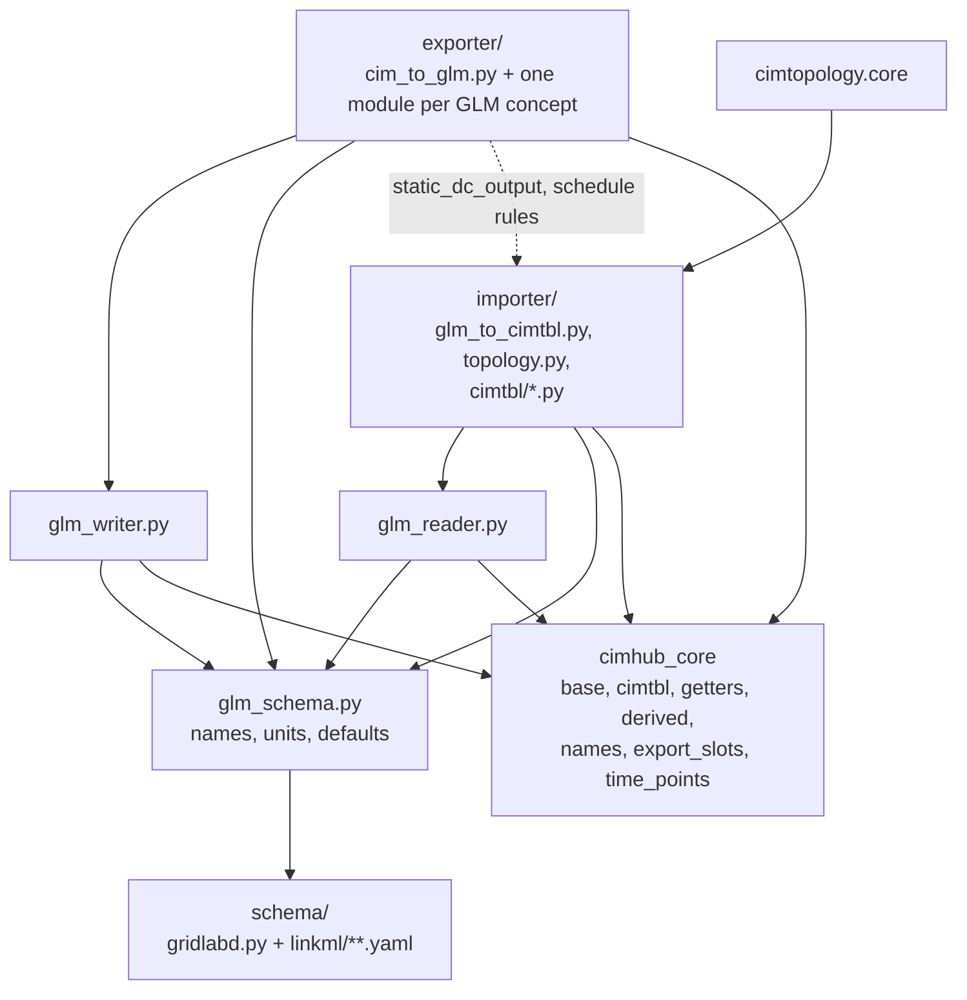

# Architecture

The package is `cimhub_gridlabd`, under
[`cimhub_gridlabd/src/cimhub_gridlabd/`](https://github.com/PNNL-CIM-Tools/CIMHub/tree/develop/cimhub_gridlabd/src/cimhub_gridlabd).
It has four parts, one per core ABC, plus the schema they share. The hub and spoke layout, and what core holds, are
on the core site's [converter API](https://pnnl-cim-tools.github.io/CIMHub/core/developer/converter-api/) page.

The importer reads the `GlmModel` the reader defines. The exporter returns a `GlmModel` and `cim_to_glm` hands it to
the writer. Two exporter modules import from the importer so a rule is written once: `exporter/inverter.py` takes
`static_dc_output` (GridLAB-D's PV formula) and `exporter/schedule.py` takes the schedule rule constants
(`DAY_NAMES`, `DAY_SETS`, `LAST_DAY`, `MINUTES_PER_DAY`).

## How the four ABCs are implemented

| Core class | Here | Entry point |
|---|---|---|
| `FormatReader` | `GlmReader(source, *, defines=None)` binds a `.glm` path and the macros the caller would pass to `gridlabd -D`; `read_all()` parses the file tree and returns a `GlmModel`. | `GlmReader(path).read_all()` |
| `FormatWriter` | `GlmWriter`: `write(model, destination)` writes the deck and each player's tape beside it; `deck(model)` returns the text; `serialize(obj, expressions=None)` renders one object block. | `GlmWriter().write(model, "out.glm")` |
| `CimtblImporter` | `GlmImporter(name, *, authority, substation, feeder, time_points)` implements `to_cimtbl`; `to_cim` adds the players' and schedules' points to the core one. `bound_parts` is core's default (none). | `glm_to_cim(model, name=...)` |
| `FormatExporter` | `GlmExporter(time_points=None).to_model(network, *, name_source, switch_state)` returns a `GlmModel`. | `cim_to_glm(network, "out.glm")` |

`glm_to_cim` and `cim_to_glm` build the object and make the one call; `cim_to_glm` then writes the model with
`GlmWriter`. `GlmImporter.to_cim` takes a parsed model and never a path; `cim_to_glm` takes a destination because
writing is its job. The package `__init__.py` exports only `__version__`, so import from the modules: the table
above names them below. The class-level contracts are in the core
[converter API](https://pnnl-cim-tools.github.io/CIMHub/core/developer/converter-api/).

## Module map

### Top level

| Module | What it does | Depends on |
|---|---|---|
| `glm_reader.py` | `GlmReader`, `GlmModel`, `GlmParseError`, `read_tape`, `PLAYER_CLASS`: tokenizes a `.glm`, builds raw objects, expands macros, types each value, adds the records. | `glm_schema`, `schema`, `cimhub_core` (`GraphModel`, `base`) |
| `glm_schema.py` | `slots`, `slot_for_property`, `class_registry`, `registry_unit`, `SlotInfo`: GLM property names, declared units and `glm_default` per dataclass slot, read from the YAML at run time. | `schema`, `pyyaml` |
| `glm_writer.py` | `GlmWriter`, `WRITE_ORDER`, `format_float`, `format_complex`, `format_value`, `tape_text`: a `GlmModel` to one deck. | `glm_reader` (`GlmModel`), `glm_schema`, `schema`, `cimhub_core.base` |
| `schema/gridlabd.py` | The generated dataclasses, one per GLM class. Never edited by hand. | `linkml_runtime` |
| `schema/linkml/` | The LinkML YAML the module is generated from, and the annotations the code reads. | |
| `schema/cpp_parser.py`, `property_parser.py`, `linkml_generator.py` | The three scripts that scrape the GridLAB-D C++ source into the YAML. They are run by hand, never imported. | |

### Importer

| Module | What it does | Depends on |
|---|---|---|
| `importer/glm_to_cimtbl.py` | `GlmImporter`, `glm_to_cim`, `MAPPING_ORDER`, `CLASSIFIED`, `Site`, `site()`, `map_master`, `check_expressions`, `feeder_heads`: the orchestrator. | every mapper, `topology`, `cimtopology.core`, `cimhub_core` |
| `importer/topology.py` | `glm_network(model)`: the model as a `cimtopology.core.Network` (sources, branches, transformer coils); `bus_roots`, `swing_buses`, `service_buses`, `coil_rated`, `crossed_phases`, `check_end_phases`. | `cimtopology.core`, `cimprofiles.units` |

Each mapper in `importer/cimtbl/` has a `FIELDS` classification and a `map_<class>(model, ...)` function that returns
one `Document`. Shared helpers come first, then the mappers by what they map.

| Module | GLM class | Output file | Also depends on |
|---|---|---|---|
| `catalog.py` | not a table: the object header slots, conductor ratings, `native_name`, `label`, `referenced`, `limit_types`, `provenance` | | |
| `link.py` | not a table: the slots every line and switch shares, `classify`, `ends`, `link_ratings`, `Limits` | | `catalog` |
| `bus.py` | every `node` and `triplex_node` subclass, and the swing sources (`substation` and `bustype SWING`) | `bus`, `source` | `topology` |
| `conductor.py` | `overhead_line_conductor`, `underground_line_conductor`, `triplex_line_conductor` (`CATALOGS`) | one file per class | `catalog` |
| `spacing.py` | `line_spacing` | `line_spacing` | `catalog` |
| `configuration.py` | `line_configuration`, `triplex_line_configuration` | one file per class | `spacing`, `conductor`, `catalog` |
| `line.py` | `overhead_line`, `underground_line`, `triplex_line` (`LINES`) | one file per class | `configuration`, `conductor`, `link` |
| `switch.py` | `switch`, `fuse`, `recloser` (`SWITCHES`) | one file per class | `link`, `topology` |
| `series_reactor.py` | `series_reactor` | `series_reactor` | `link`, `catalog` |
| `transformer_configuration.py` | `transformer_configuration` | `transformer_configuration` | `catalog`, `topology` |
| `transformer.py` | `transformer` | `transformer` | `transformer_configuration`, `link`, `topology` |
| `regulator.py` | `regulator` with its `regulator_configuration` | `regulator` | `catalog`, `link`, `topology` |
| `player.py` | `player` | `player` | `catalog`, `link` |
| `schedule.py` | `schedule` (a block, not an object) | `schedule` | `player` |
| `load.py` | `load`, `triplex_load`, and a plain `triplex_node`'s power (`LOAD_CLASSES`) | `load`, `triplex_load`, `triplex_node` | `bus`, `player`, `catalog`, `link`, `topology` |
| `capacitor.py` | `capacitor` | `capacitor` | `bus`, `catalog`, `link`, `topology` |
| `inverter.py` | `inverter`, with its nested `solar` or `battery` | `inverter` | `catalog`, `link` |

`zip_fractions.cimtbl`, the three ZIP characteristics the loads name, has no mapper here: it is
`cimhub_core.load_response.zip_fractions()`.

### Exporter

| Module | What it does | Depends on |
|---|---|---|
| `exporter/cim_to_glm.py` | `GlmExporter`, `cim_to_glm`, `EXPORT_ORDER`, `ExportContext`: runs each module over the network, collects the records and sets the `clock`, `#set` and `module` header. | every module below, `GlmWriter`, `GlmModel` |
| `exporter/naming.py` | `Names`, `glm_safe_name`: GLM names, one namespace per deck, collisions raised. | `cimhub_core.names` |
| `exporter/units.py` | `glm_unit`, `from_percent`: the unit the exporter asks a getter for is the GLM slot's own. | `glm_schema` |
| `exporter/buses.py` | `Bus`, `bus_table`, `letters`: ConnectivityNodes as `node`, `triplex_node` and the swing `substation`. | `cimtopology.core` (voltage zones), `getters.base_voltage`, `getters.source`, `getters.terminals`, `units` |
| `exporter/line_catalog.py` | `build_catalog`, `GeometryKey`, `MatrixKey`: the conductors, spacings and configurations the lines name. | `getters.line_impedance`, `getters.spacing`, `getters.wire`, `derived` |

The export modules proper. Each has `CIM_CLASSES`, `SLOTS` and `export(context)`:

| Module | CIM class | GLM class |
|---|---|---|
| `buses.py` | `EnergySource` in `CIM_CLASSES`; every `ConnectivityNode` through `bus_table` | `node`, `triplex_node`, `substation` |
| `line.py` | `ACLineSegment` (with `line_catalog`) | `overhead_line`, `underground_line`, `triplex_line`, and their conductors, spacings and configurations |
| `switch.py` | `Switch` and its subclasses | `switch`, `fuse`, `recloser`, `sectionalizer` |
| `series_reactor.py` | `SeriesCompensator` | `series_reactor` |
| `transformer.py` | `PowerTransformer`, and an `AutoTransformer` that is not a `VoltageRegulator` | `transformer`, `transformer_configuration` |
| `regulator.py` | `VoltageRegulator` | `regulator`, `regulator_configuration` |
| `player.py` | `ConformLoadSchedule` with points (`CIM_CLASSES` is empty) | `player` |
| `schedule.py` | each `ConformLoadGroup` whose schedules hold a `Season` or `DayType` (`CIM_CLASSES` is empty) | a `schedule` block (in `GlmModel.schedules`) |
| `load.py` | `EnergyConsumer` and its subclasses | `load`, `triplex_load` |
| `capacitor.py` | `LinearShuntCompensator` | `capacitor` |
| `inverter.py` | `PowerElectronicsConnection`, with its `PhotoVoltaicUnit` or `BatteryUnit` | `inverter`, with its `solar` or `battery` |

## Boundaries

- No module in `importer/` or `exporter/` opens a file. The reader has already read the player tapes into
  `GlmModel.tapes`, and the exporter puts each player's rows in the same dict for the writer.
- Names and number formats are the writer's: the exporter modules that write expressions or schedule values take
  `format_float` from `glm_writer.py`, and only `cim_to_glm.py` uses `GlmWriter` itself.
- A module in `exporter/` may add to the model it is exporting into (`ExportContext.model`): `load` adds the
  expressions its bases need (`<player>.value*K`), `player` adds the tapes, the `player` class block and the `tape`
  module, and `schedule` adds the schedule blocks. That is the one place an exporter has a side effect, and the
  context says so in its field comment.
