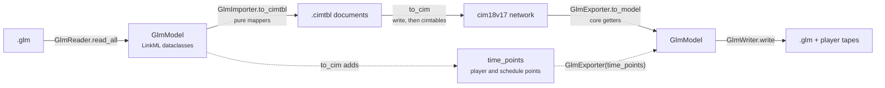

# Developer docs

How `cimhub_gridlabd` is built: the reader that parses a `.glm`, the importer that maps it to `.cimtbl` text, the
exporter that reads CIM back through the core getters, and the writer that turns the result into a `.glm`. These
pages are the map of the code. The per-class design record is in the two mapping specs, listed below.

## The two pipelines



Only the reader and the writer touch the deck files (plus the core `to_cim`, which writes the `.cimtbl` artifact so
that what a reviewer reads is exactly what was bound). Every stage returns something you can inspect. The exporter
returns the same `GlmModel` type the reader does, so an exported model can be written, or imported again.

The points of a player or schedule are not in the artifact. `GlmImporter.to_cim` puts them in the caller's
`time_points` dict (the Parquet sidecar tables), and `GlmExporter(time_points)` reads them back. See
[The importer](importer.md) and [The exporter](exporter.md).

## Pages

| Page | Covers |
|---|---|
| [Architecture](architecture.md) | One row per module in `src/cimhub_gridlabd`, what it does and what it depends on; how the core ABCs are implemented. |
| [Reader and writer](reader-writer.md) | `GlmReader` (blocks, nested objects, directives, macros, expressions, units, errors), `GlmModel`, `GlmWriter` (class order, value formats, tapes, the settings header). |
| [The importer](importer.md) | `GlmImporter`, `MAPPING_ORDER`, `CLASSIFIED`, the master, the topology walk, the mapper layout, one mapper end to end, adding one. |
| [The exporter](exporter.md) | `GlmExporter`, `EXPORT_ORDER`, `ExportContext`, naming, units, `SLOTS`, one module end to end, adding one. |
| [The LinkML schema](schema.md) | The YAML scraped from the GridLAB-D C++ source, regenerating `gridlabd.py`, the annotations the code reads, the schema reference. |
| [Testing](testing.md) | Atoms, the test types, decks and goldens, the GridLAB-D oracle, environment variables and skips. |
| [Import mapping (.cimtbl)](../CIMTBL_MAPPING.md) | The approved design record of the import: for each GLM class, every property classified copied, mapped, structural, derived or untranscribed, the fail-fast rules and the expected differences. |
| [Export mapping](../EXPORT_MAPPING.md) | The approved design record of the export: for each CIM class, the GLM slots written, the rules, the slot tables generated from `SLOTS` and the expected differences. |

The mapping specs say what each mapper or exporter module must do; these pages say where the code is. Where a spec
and the code disagree, the code wins, and the spec should be corrected.

For what core provides, see the core site: the
[converter API](https://pnnl-cim-tools.github.io/CIMHub/core/developer/converter-api/), the
[`.cimtbl` import contract](https://pnnl-cim-tools.github.io/CIMHub/core/developer/cimtbl/), the
[canonical shapes](https://pnnl-cim-tools.github.io/CIMHub/core/developer/shapes/) and the
[test helpers](https://pnnl-cim-tools.github.io/CIMHub/core/developer/testing/).

## Rules that keep it simple

These are the invariants I1 to I9 from the repository's
[`CLAUDE.md`](https://github.com/PNNL-CIM-Tools/CIMHub/blob/develop/CLAUDE.md), as they show up in this package. A
change that breaks one needs a reason in the pull request.

| # | Rule | In this package |
|---|---|---|
| I1 | The `.cimtbl` artifact is the only input to CIM. | `GlmImporter.to_cim` is the core `to_cim` plus the time points step: it writes the documents and loads the written files. There are no `bound_parts`; every part is mapped from the GLM records alone. |
| I2 | Values are copied verbatim, in source units, with the unit in the column header. | A value keeps the unit it was written in (`30 in`): the reader stores the number, `GlmModel.written_units` holds the unit, and `GlmModel.unit` gives it, else the schema's declared unit. A column header carries that unit (`r (ohm)`). `glm_schema.registry_unit` only respells (`Ohm/mile` to `ohm/mile`). Where a header can carry the unit the mapper writes the value as written: a capacitor's `nomQ (MVAr)`, `nomU (V)` and `bPerSection (MVAr/V^2)`, a transformer's `loadLoss` in its `power_rating`'s unit (`kVA` gives `kW`). Some mappers still convert with `pint` where one header cannot carry the units: values summed or combined across slots written in different units (`load.py`'s ZIP split to VA, a delay of `dwell_time` + `time_delay`), unitless CIM targets (a control's `targetValue`), and per unit to a `PerCent` attribute (`percentImpedance`, `stepVoltageIncrement`), which cimtables takes only as percent. |
| I3 | Every field of a mapped native class is classified. | Each mapper module has a `FIELDS` dict and its test calls `check_fields(FIELDS, NATIVE_CLASS)`. `CLASSIFIED` collects them all. The exporter's mirror is `SLOTS`, checked by `check_slots`. |
| I4 | One artifact file per native table. | `MAPPING_ORDER` gives one document per GLM class (`overhead_line.cimtbl`, `transformer.cimtbl`, ...); the master imports them, catalogs first. `bus.cimtbl` and `source.cimtbl` come from the topology walk, not from one table, and `regulator_configuration` is written inside `regulator.cimtbl`. |
| I5 | Spokes never construct CIM objects. | The mappers return `cimtables.document` rows and tables. Exporters read CIM and build only GLM dataclasses. |
| I6 | CIM 18 templates, never `*Info` catalogs. | A `line_configuration` is a `WireConfiguration` (a template `PerLengthPhaseImpedance`, or a geometry with its spacing); a `transformer_configuration` is a `TransformerTankConfiguration`. A `line_spacing` is a `ConductorDistanceSpacing`, since GLM gives distances and never coordinates. |
| I7 | Mappers are pure. | The `map_*` functions take a `GlmModel` and return `Document`s. The reader (which also reads player tapes), the writer (which also writes them) and `to_cim` are the only code that touches files. |
| I8 | Fail fast. | An unknown property, an unmapped enum value, an unresolved reference, an expression in a slot a mapper reads and ambiguous input all raise, naming the record. The reader raises `GlmParseError` with file and line; mappers and exporters raise `ValueError`. Import keeps names as written. Export has to sanitize, because GLM cannot carry every character: `glm_safe_name`, with collisions raised. |
| I9 | Upstream first. | Topology is `cimtopology.core`; every CIM read is a `cimhub_core.getters` function; naming comes from `cimhub_core.names`, `SLOTS` from `cimhub_core.export_slots`, and derived values (`c_from_b`, `kron_reduce`) from `cimhub_core.derived`. |

## Working on it

```bash
uv sync                                  # the ../CIM-* path sources are editable sibling checkouts
scripts/test-all.sh gridlabd             # this package's tests, in one pytest process
scripts/test-all.sh gridlabd -- -x -q    # arguments after -- go to pytest
CIMHUB_UPDATE_GOLDENS=1 scripts/test-all.sh gridlabd   # rewrite goldens; review the diff before committing
scripts/leak-gate.sh                     # must print "clean" before every commit
scripts/build-docs.sh gridlabd --serve   # preview this site at http://127.0.0.1:8000
scripts/gen-schema.sh gridlabd           # regenerate schema/gridlabd.py after a schema YAML change
```

Never run one pytest over the whole repository: cimtables sets the CIM profile and the model scope process-wide, so
each package needs its own interpreter. The decks that are not vendored are skipped unless you pass `--roundtrip` and
point `CIMHUB_GLM_DECKS` at them; see [Testing](testing.md).

`scripts/build-docs.sh gridlabd` first generates the schema reference (`docs/schema/`) from the LinkML schema, then
builds this site with `--strict`. Both are described on [The LinkML schema](schema.md).
