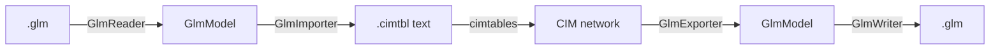

# User guide

You have a GridLAB-D `.glm` model and want CIM, or a CIM model and want a `.glm`. This guide runs both directions
on the IEEE 13-node model that ships in the repository's tests.

-   __Getting started__

    ---

    [Installation](installation.md), then a [quick start](quickstart.ipynb) notebook that reads the model, imports
    it to CIM, looks at the `.cimtbl` text and exports a `.glm`.

-   __Converting__

    ---

    [Import](import.md) (`.glm` to CIM): reader and importer options, the artifact files, what raises.
    [Export](export.md) (CIM to `.glm`): names, the header, switch state, what raises.
    [Players and schedules](time-series.md): time series and the `time_points` tables.
    [Round trip](roundtrip.md): checking a converted model against the original.

-   __What converts__

    ---

    [What converts](coverage.md) lists every GLM class the importer and exporter handle, and the ones they skip.
    The [conversion reference](../reference/index.md) gives each class's CIM mapping.

## The pipeline

`glm_to_cim` runs the middle row (model to CIM) and `cim_to_glm` the last two steps. The shared parts of the
pipeline, the `.cimtbl` contract and the getters that read CIM, are documented in
[CIMHub core](https://pnnl-cim-tools.github.io/CIMHub/core/).
