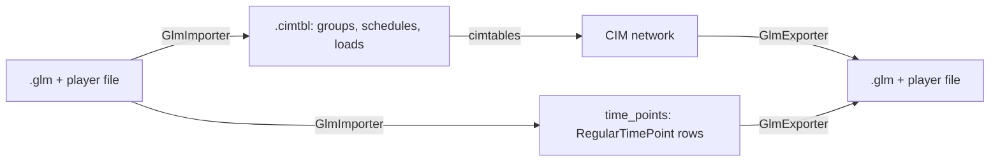

# Players and schedules

A GridLAB-D load can follow a time series in two ways that CIMHub converts: a **player** (a tape file of
`time,value` rows) and a **schedule** (a block of cron-style rules that repeat by month and weekday). Both reach a
load through its `base_power`, as a multiplier of the load's own power. This page follows each one from the `.glm` to
CIM and back.

## What converts

| GLM | CIM | Points |
|---|---|---|
| `object player` read as `<name>.value` | one `ConformLoadGroup` `lg_<name>` and one `ConformLoadSchedule` `ls_<name>` | the tape's values, in the `time_points` tables |
| `schedule <name> { ... }` read as `<name>*K` | one `ConformLoadGroup` `lg_<name>`, and one `ConformLoadSchedule` per `Season` and `DayType` | one day of values per schedule, in the `time_points` tables |
| a `load` or `triplex_load` whose `base_power_X` is `<player>.value*K` or `<schedule>*K` | a `ConformLoad` of that group, with `p` and `q` computed from K | none |

A schedule's `value1` is a multiplier of each load's `p` and `q` together (`value1Unit` is `none`). A group
is shared the way a GridLAB-D player or schedule is: every load that names it is a `ConformLoad` of the group.



The `.cimtbl` text holds the schedule objects and no points. The points go to the `time_points` dict, and from
there to a Parquet file beside the CIM XML. The exporter needs the same dict to write a player's rows.

## How a load reads a player or schedule

A load names its player or schedule in `base_power`:

```text
object load { name ld_play; parent n5; phases AN; nominal_voltage 2401.78;
  base_power_A zipload.value*19723.08; current_fraction_A 1.0; current_pf_A 0.861934; }
```

| Form | Source | Group |
|---|---|---|
| `<player>.value*<number>` | the player named before `.value` | `lg_<player>` |
| `<schedule>*<number>` | the schedule | `lg_<schedule>` |

The number K is the load's base power. The importer splits K by the load's fractions and power factors into `p` and
`q` as it does for any other `base_power`, so the consumer's `p` and `q` are the load at a multiplier of 1. Any other
expression in a `base_power` slot raises. The rules a record must keep:

- A record's bases follow one source. Two different players or schedules on one record raise, and so does a
  phase with power and no source beside a phase with one: a `ConformLoad` has one group and scales every phase.
- A player and a schedule of the same name raise when a load reads them, because both groups would be `lg_<name>`.
- A schedule that a load reads but the deck does not define raises.
- A player that a load reads but the deck does not define does not raise. Its group is written with no schedule, with
  one warning. The IEEE 13-node deck is an example: its loads read `ieeezipload.value`, and GridAPPS-D's run file
  (not the deck) declares the player. See the [example](#a-player-through-the-ieee-13-node-model).

## Players

### The deck

The reader accepts one pattern, the GridAPPS-D run file's:

```text
module tape;
class player { double value; }
object player { name zipload; file zipload.player; loop 0; }
```

A `class` block other than `class player { double value; }` raises in the reader. The importer raises on a `player`
that sets `parent`, `property`, `filetype` or `mode` (only a player read as `<name>.value` converts), on a `loop`
above 0 (a schedule has one pass), on a player with no `file`, and on a deck with a player but no `class player`.

The reader reads each player's file beside the file that declares the player. A row is `time,value`. Comment and blank
lines are dropped, and a value ends at `;`. A missing file or a row with no comma raises.

### The schedule it becomes

| Column | Value |
|---|---|
| `startTime` | the first row's time, with its zone as an offset (`2009-07-21 00:00:00 EDT` is `2009-07-21T00:00:00-04:00`) |
| `timeStep (s)` | the step between rows (`+1m` is 60) |
| `value1Unit` | `none` |

The first row must be absolute, `YYYY-MM-DD HH:MM:SS ZONE`, with a zone from this list: `UTC`, `GMT`, `EST`, `EDT`,
`CST`, `CDT`, `MST`, `MDT`, `PST`, `PDT`. Each later row is `+N[smhd]` after the row before it, or absolute. The
step must be the same between every pair of rows, and positive. A one-row tape has no `timeStep`. A time or value
that does not parse raises, naming the player.

The `player.cimtbl` of the atom `tests/atoms/player/player.glm`:

```text
Table ConformLoadGroup: mRID, name
    lg_zipload, zipload

Table ConformLoadSchedule: mRID, name, startTime, timeStep (s), value1Unit, ConformLoadGroup
    # untranscribed: all_events_delta=false
    ls_zipload, zipload, 2009-07-21T00:00:00-04:00, 60.0, none, lg_zipload
```

An `# untranscribed:` line lists the player's properties that have no CIM home (here `all_events_delta`). The
[import mapping](../CIMTBL_MAPPING.md) classifies every player property.

## Schedules

### The rules

Each rule is `minutes hours days months weekdays [value]`. GridLAB-D reads them like this, and the importer's tests
check it against the engine:

- Each field is `*`, a number, a range `a-b` or a comma list of them, with the ends included.
- Months run 1 to 12 and weekdays 0 (Sunday) to 6.
- A rule with no value gives 1. A time no rule covers gives 0.
- Two rules on one minute make GridLAB-D fail to load, and the importer raises.
- A rule ends at `;` or at the end of its line.

The importer raises on a day of the month other than `*`, a nested block, a field off that form or outside its range,
a rule of any count of fields other than five or six, and a value that is not a number.

### Seasons and day types

The importer gives each month and weekday its day of 1440 minute values, then groups them.

| CIM | Built from | Name |
|---|---|---|
| `Season` | a run of consecutive months whose seven days agree (a run that ends in December joins one that starts in January) | `season_<first>_<last>`, for example `season_12_02`, from `--12-01` to `--02-29` |
| `DayType` | the weekdays of a season whose days agree | `all`, `weekday`, `weekend`, `sunday` to `saturday`; another set joins the day names with `_` (`monday_wednesday`) |
| `ConformLoadSchedule` | one per season and day type | `ls_<schedule>` for a schedule of one day, else `ls_<schedule>_<first>_<last>_<day type>` |

Each schedule starts at `00:00:00` (a time of day). Its `timeStep (min)` is the largest divisor of a day on which
the day's value changes only at step boundaries, and its points are one day of values at that step.

The atom `tests/atoms/schedule/schedule.glm` holds three schedules. `zip1` has half-hour rules every day, `heat` has
a winter (`12,1-2`) and the rest of the year, each with weekday and weekend rules and no summer weekend rule, and
`waterdemand` is read by no load. It imports as these `ConformLoadSchedule`s:

| mRID | Season | DayType | timeStep | Points |
|---|---|---|---|---|
| `ls_zip1` | `01-12` | `all` | 30 min | 48 |
| `ls_heat_12_02_weekday` | `12-02` | `weekday` | 60 min | 24 |
| `ls_heat_12_02_weekend` | `12-02` | `weekend` | 1440 min | 1 |
| `ls_heat_03_11_weekday` | `03-11` | `weekday` | 120 min | 12 |
| `ls_heat_03_11_weekend` | `03-11` | `weekend` | 1440 min | 1 (value 0) |

A schedule that no load reads (`waterdemand`, a house's) is not converted. The master's comment counts it
(`not mapped: schedule 1`).

## Where the points go

The points are `RegularTimePoint` rows: the schedule's `uri()`, a `sequenceNumber` from 0, and `value1`. A point's
time is `startTime` + `sequenceNumber` x `timeStep`. The table format, the writer and the reader are in
[Time series and schedules](https://pnnl-cim-tools.github.io/CIMHub/core/guide/time-points/) in the core docs, and
need the `time-points` extra ([installation](installation.md)).

Pass a dict to the importer and it adds the table after the network is bound:

```python
from cimhub_gridlabd.glm_reader import GlmReader
from cimhub_gridlabd.importer.glm_to_cimtbl import glm_to_cim

model = GlmReader("cimhub_gridlabd/tests/atoms/schedule/schedule.glm").read_all()
time_points = {}
network = glm_to_cim(model, name="atom", time_points=time_points)
print(sorted(time_points))   # ['RegularTimePoint']
```

`GlmImporter(name, time_points=...)` takes the same keyword. Without it the points are dropped, with one warning
that lists the schedules (`the points of N player(s) and schedule(s) are dropped: pass GlmImporter(time_points={}) to
keep them`). The schedules themselves are still in the network.

To keep the points beside the CIM XML, call `write_time_points(time_points, xml_path)` from `cimhub_core.time_points`.
It writes `<stem>.RegularTimePoint.parquet`, and `read_time_points(xml_path, network)` gives the dict back.

## Export

`GlmExporter(time_points)` and `cim_to_glm(network, destination, time_points=...)` take the same dict. Without a
`RegularTimePoint` table every group is written static.

### A player

A `ConformLoadSchedule` with points that has no `Season` or `DayType` becomes a player named after its group, with
its tape `<name>.player` written beside the deck.

- The first row is at `startTime` in GMT, which GridLAB-D reads under any clock zone. Each later row is
  `+<step>s`. A step that is not a whole number of seconds raises, and so does a `startTime` with no offset.
- `value2` that differs from `value1` raises, because a GLM base scales `p` and `q` together.
- The deck gets `module tape;` and `class player { double value; }`.
- Each `ConformLoad` of the group writes `base_power_X` as `<name>.value*<base>`, an expression the writer prints as
  it is. A load's 240 V part must follow the same player as its legs.
- The `clock` starts and stops at the earliest player start, so each load runs at its base times the first point. To
  play the schedule, set a later `stoptime` on the model before you write it.

### A schedule

A conform group whose schedules are all days (each has a `Season` or `DayType`) and have points becomes a `schedule`
block named after the group, which each load of the group reads as `<name>*<base>`. Each day becomes cron rules:
each run of equal values, split at the hours, on the season's months and the day type's weekdays. A value of 0 is no
rule, as GridLAB-D gives 0 where none applies. The rules come back as the importer read them, but for spacing,
order and the form of the numbers.

A group that holds both a time series (a schedule with no `Season` or `DayType`) and days raises on export. A day raises when:

- it does not start at `00:00:00`, or its points do not fill 24 hours in whole minutes;
- its season does not start on the 1st and end on a month's last day;
- its day type is a name the importer does not write (`all`, `weekday`, `weekend`, day names joined by `_`);
- two days of one group cover the same month and weekday;
- its `value2` differs from `value1`.

### Written static

A load is written with its constant `p` and `q` and no scheduled base, and the exporter logs one warning that names
the groups (`N load group(s) are written static (no schedule, no points, or a NonConformLoad's): [...]`), when:

- its group has no schedule (a reference to a player the deck does not hold would leave a deck GridLAB-D cannot
  load);
- its schedule or one of its days has no points;
- it is a `NonConformLoad`, whose schedule is in power units and not a multiplier.

## A player through the IEEE 13-node model

The vendored IEEE 13-node deck's loads read `ieeezipload.value`, and `IEEE/zipload_schedule.player` holds the 1,440
one-minute multipliers GridAPPS-D runs it with. The deck does not declare the player, so this run file does, then
includes the deck. The reader takes the deck's `${VSOURCE}` from `defines`, as `gridlabd -D VSOURCE=...` would. Run
it from the repository root.

```python
import shutil
import tempfile
from pathlib import Path

import cimprofiles.cim18.cim18v17 as cim

from cimhub_core.time_points import REGULAR_TIME_POINT_CLASS, rows_by_schedule
from cimhub_gridlabd.exporter.cim_to_glm import GlmExporter
from cimhub_gridlabd.glm_reader import GlmReader
from cimhub_gridlabd.glm_writer import GlmWriter
from cimhub_gridlabd.importer.glm_to_cimtbl import glm_to_cim

decks = Path("cimhub_gridlabd/tests/decks/IEEE")
work = Path(tempfile.mkdtemp())
shutil.copy(decks / "IEEE13_cdpsm.glm", work)
shutil.copy(decks / "zipload_schedule.player", work / "ieeezipload.player")
(work / "run.glm").write_text("""module tape;
class player { double value; }
object player { name ieeezipload; file ieeezipload.player; loop 0; }
#include "IEEE13_cdpsm.glm"
""")

# import: the points go to time_points
time_points = {}
model = GlmReader(work / "run.glm", defines={"VSOURCE": "66395.28"}).read_all()
network = glm_to_cim(model, name="IEEE13_cdpsm", time_points=time_points)

[schedule] = network.graph[cim.ConformLoadSchedule].values()
rows = rows_by_schedule(time_points[REGULAR_TIME_POINT_CLASS])[schedule.uri()]
print(schedule.mRID, schedule.startTime, schedule.timeStep)
print(len(network.graph[cim.ConformLoad]), "loads;", rows.num_rows, "points;", rows.column("value1").to_pylist()[0])

# export: the same dict gives the player its rows
exported = GlmExporter(time_points).to_model(network, name_source="name")
GlmWriter().write(exported, work / "out" / "exported.glm")
print(sorted(path.name for path in (work / "out").iterdir()))
print(exported.clock["starttime"], exported.tapes["ieeezipload"][:2])
```

The output is:

```text
ls_ieeezipload 2009-07-21T00:00:00-04:00 60.0 second
10 loads; 1440 points; 0.425364
['exported.glm', 'ieeezipload.player']
'2009-07-21 04:00:00' [('2009-07-21 04:00:00 GMT', '0.425364'), ('+60s', '0.42153')]
```

The start came back as the same instant in GMT: 00:00 EDT is 04:00 GMT. In the exported deck 19 `base_power_` lines
read `ieeezipload.value*<base>`.

Without the run file the same deck imports with one warning (`1 player(s) named by loads are not in the deck:
['ieeezipload']; their groups have no schedule`) and exports its loads static.

### A schedule through the atom

The same calls on `tests/atoms/schedule/schedule.glm`:

```python
from cimhub_gridlabd.exporter.cim_to_glm import GlmExporter
from cimhub_gridlabd.glm_reader import GlmReader
from cimhub_gridlabd.importer.glm_to_cimtbl import glm_to_cim

time_points = {}
model = GlmReader("cimhub_gridlabd/tests/atoms/schedule/schedule.glm").read_all()
network = glm_to_cim(model, name="atom", time_points=time_points)
exported = GlmExporter(time_points).to_model(network, name_source="name")
print(exported.schedules["heat"])
print(len(exported.schedules["zip1"]), exported.expressions[("ld_zip", "base_power_A")])
```

```text
['* 6-21 * 3-11 1-5 0.6', '* 0-6 * 12,1-2 1-5 1.2', '* 7-23 * 12,1-2 1-5 0.9', '* * * 12,1-2 0,6 1.1']
12 zip1*19723.08
```

These are the four rules of `heat`, in another order. The summer weekend had no rule and has none.
`GlmExporter()` with no `time_points` writes both loads static.

## Other formats

A player's group is also a `LoadShape` in the OpenDSS exporter and a shared series in the GDM exporter. A schedule's
days by season and day type have no OpenDSS or GDM form, so both write the load static and name the group in one
warning. See the [OpenDSS site](https://pnnl-cim-tools.github.io/CIMHub/opendss/) and the
[loads reference](../reference/loads.md).
