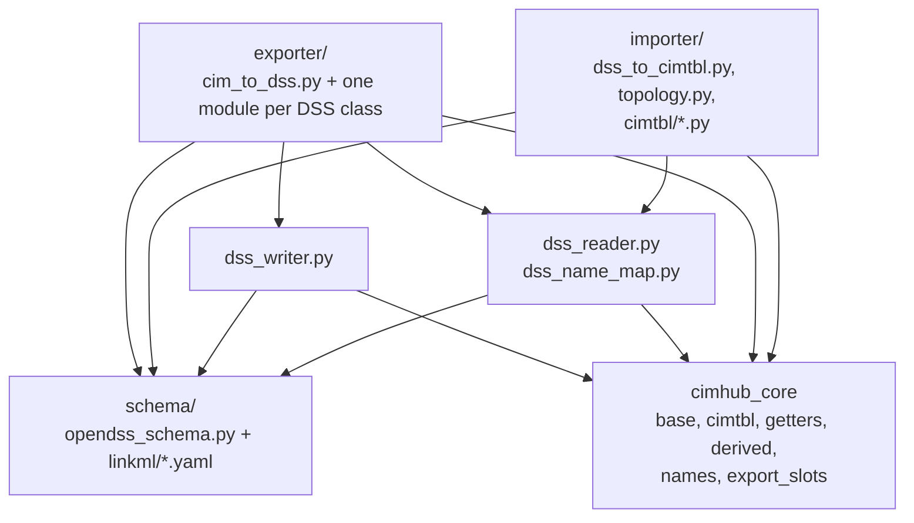

# Architecture

The package is `cimhub_opendss`, under
[`cimhub_opendss/src/cimhub_opendss/`](https://github.com/PNNL-CIM-Tools/CIMHub/tree/develop/cimhub_opendss/src/cimhub_opendss).
It has four parts, one per core ABC, plus the schema they share. The hub and spoke layout, and what core holds, are
on the core site's [converter API](https://pnnl-cim-tools.github.io/CIMHub/core/developer/converter-api/) page.

The importer reads `dss_defaults` from the reader (the schema's `dss_default` values, typed). The exporter returns
a `DssModel` (defined in the reader) and `cim_to_dss` hands it to the writer.

## How the four ABCs are implemented

| Core class | Here | Entry point |
|---|---|---|
| `FormatReader` | `DssReader(source)` binds a master `.dss` path; `read_all()` parses the file tree once and returns a `DssModel`. | `DssReader(path).read_all()` |
| `FormatWriter` | `DssWriter`: `write(model, destination, *, per_class=False)` writes the deck; `serialize(obj)` renders one `New` command. | `DssWriter().write(model, "out.dss")` |
| `CimtblImporter` | `DssImporter(name, *, authority, length_unit, device_geometry, time_points)` implements `to_cimtbl` and `bound_parts`; `to_cim` adds the yearly shapes' time points to the core one. | `dss_to_cim(model, name=...)` |
| `FormatExporter` | `DssExporter(time_points=None).to_model(network, *, name_source, circuit_source, switch_state)` returns a `DssModel`. | `cim_to_dss(network, "out.dss")` |

`dss_to_cim` and `cim_to_dss` build the object and make the one call; `cim_to_dss` then writes the model with
`DssWriter`. `DssImporter.to_cim` takes a parsed model and never a path; `cim_to_dss` takes a destination because
writing is its job. The class-level contracts are in the core
[converter API](https://pnnl-cim-tools.github.io/CIMHub/core/developer/converter-api/).

## Module map

### Top level

| Module | What it does | Depends on |
|---|---|---|
| `__init__.py` | Exports `DssReader`, `DssModel`, `DssParseError`, `DssWriter`, `DssImporter`, `dss_to_cim`, `DssExporter`, `cim_to_dss`. | the four modules below |
| `dss_reader.py` | `DssReader`, `DssModel`, `DssParseError`, `dss_defaults`: tokenizes a deck, follows `Redirect`/`Compile`, applies `New`, `Edit`, `like=`, `BatchEdit`, `Set`, `Open`, `Close` in order. | `dss_name_map`, `schema`, `cimhub_core` (`base`, `cimtbl.schema_defaults`, `serialization`) |
| `dss_name_map.py` | `get_class_map`, `build_type_registry`, `DssClassMap`: DSS property name (and abbreviation) to dataclass field, the enum value tables, the DSS class name to dataclass table. Reads the schema YAML at run time. | `schema`, `pyyaml` |
| `dss_writer.py` | `DssWriter`, `WRITE_ORDER`, `dss_safe_name`, `format_float`: a `DssModel` to one deck, command order and property order from the schema annotations. | `schema`, `cimhub_core` (`base`, `serialization`) |
| `schema/opendss_schema.py` | The generated dataclasses, one per DSS class. Never edited by hand. | `linkml_runtime` |
| `schema/linkml/` | The LinkML YAML the module is generated from, and the annotations the code reads. | |

### Importer

| Module | What it does | Depends on |
|---|---|---|
| `importer/dss_to_cimtbl.py` | `DssImporter`, `dss_to_cim`, `MAPPING_ORDER`, `Site`, `site()`, `map_master`, `map_buses`: the orchestrator. | every mapper, `topology`, `cimtopology.core.walk`, `cimhub_core` |
| `importer/topology.py` | `dss_network(native)`: the deck as a `cimtopology.core.Network` (sources, branches, transformer coils). | `cimtopology.core`, the `transformer` and `vsource` mappers |

Each mapper in `importer/cimtbl/` is `map_<class>(native, ...)` returning one `Document`, plus a `FIELDS` classification
(`wire.py` and `geometry.py` hold several classes, so several `FIELDS`).
They group by what they map:

| Module | DSS class | Output file | Also depends on |
|---|---|---|---|
| `wire.py` | `WireData`, `CNData`, `TSData` (`CATALOGS`) | `wiredata`, `cndata`, `tsdata` | `linecode` (length units) |
| `geometry.py` | `LineSpacing`, `LineGeometry` | `linespacing`, `linegeometry` | `linecode`, `wire` |
| `linecode.py` | `LineCode` | `linecode` | `derived.capacitance`, `derived.sequence` |
| `xfmrcode.py` | `XfmrCode` | `xfmrcode` | `transformer` |
| `vsource.py` | `Vsource`, `New Circuit` | `vsource` | `transformer` (`parse_bus`) |
| `line.py` | `Line`, with the `Fuse`, `Recloser`, `SwtControl` that switch it (`CONTROLS`) | `line` | `linecode`, `geometry`, `wire`, `transformer` |
| `reactor.py` | series `Reactor` | `reactor` | `line`, `transformer` |
| `transformer.py` | `Transformer` (the winding parser, `parse_bus`, `is_split_phase`) | `transformer` | |
| `regcontrol.py` | `RegControl` | `regcontrol` | `transformer`, `derived.regulator` |
| `loadshape.py` | `LoadShape` named as `yearly` by a load, PV, storage or generator | `loadshape` | |
| `injection.py` | not a table: the terminal and phase rules shared by the one-terminal devices | | `transformer` |
| `load.py` | `Load` | `load` | `injection`, `loadshape`, `load_response` |
| `capacitor.py` | `Capacitor` | `capacitor` | `injection` |
| `capcontrol.py` | `CapControl` | `capcontrol` | `injection`, `capacitor`, `line`, `derived.control_band` |
| `inverter.py` | not a table: the `PowerElectronicsConnection` row of PVSystem and Storage | | `injection` |
| `pvsystem.py` | `PVSystem` | `pvsystem` | `injection`, `inverter`, `loadshape` |
| `storage.py` | `Storage` | `storage` | `injection`, `inverter`, `loadshape` |
| `generator.py` | `Generator` | `generator` | `injection`, `loadshape` |
| `buscoords.py` | `BusCoords`, `LatLongCoords` | `buscoords` (a `bound_parts` part) | |

`bus.cimtbl` and the core `zip_fractions.cimtbl` have no mapper module here: `map_buses` and
`cimhub_core.load_response.zip_fractions` produce them.

### Exporter

| Module | What it does | Depends on |
|---|---|---|
| `exporter/cim_to_dss.py` | `DssExporter`, `cim_to_dss`, `EXPORT_ORDER`, `ExportContext`: runs each module over the network and collects the records. | every module below, `DssWriter` |
| `exporter/naming.py` | `Names`: DSS names, per namespace, with collisions raised. | `cimhub_core.names`, `dss_safe_name` |
| `exporter/options.py` | `options_record`: circuit name, base frequency, voltage bases, earth model, open terminals. | `getters.earth`, `linegeometry` |
| `exporter/buses.py` | `bus_ref`: `650.1.2.3` references. `BUS_CLASSES`. | `naming` |
| `exporter/controls.py` | `pt_phase`, `control_enabled`: what RegControl and CapControl write alike. | `getters` |
| `exporter/injection.py` | `device_connection`, `device_kv`: the connection of a one-terminal device. | `getters`, `buses` |
| `exporter/inverter.py` | `inverter_pieces`: one DSS device per unit behind a `PowerElectronicsConnection`. | `getters.der`, `injection` |
| `exporter/windings.py` | `read_unit`, `winding_values`: a transformer unit's DSS winding values, shared by three modules. | `getters.transformer`, `getters.tap_changer` |

The export modules proper. Each has `CIM_CLASSES`, `SLOTS` and `export(context)`:

| Module | CIM class | DSS class |
|---|---|---|
| `vsource.py` | `EnergySource` | `Vsource` (the circuit's is `New Circuit`) |
| `wire.py` | `WireInfo` kinds | `WireData`, `CNData`, `TSData` |
| `linecode.py` | `PerLengthPhaseImpedance`, `PerLengthSequenceImpedance` | `LineCode` |
| `linegeometry.py` | `WireConfiguration` with a `WireSpacing` | `LineGeometry` |
| `line.py` | `ACLineSegment` | `Line` |
| `switch.py` | `Switch` and its subclasses | `Line` with `Switch=y`, `Fuse`, `Recloser`, `SwtControl`, `Open` |
| `xfmrcode.py` | `TransformerTankConfiguration` | `XfmrCode` |
| `transformer.py` | `PowerTransformer`, `AutoTransformer`, `VoltageRegulator` | `Transformer` |
| `regcontrol.py` | `TapChangerControl` | `RegControl` |
| `loadshape.py` | `ConformLoadSchedule`, `EnergyConnectionSchedule` (no conducting equipment) | `LoadShape` |
| `load.py` | `EnergyConsumer`, `ConformLoad`, `NonConformLoad`, `StationSupply` | `Load` |
| `capacitor.py` | `LinearShuntCompensator` | `Capacitor` |
| `capcontrol.py` | `RegulatingControl` | `CapControl` |
| `pvsystem.py` | `PowerElectronicsConnection` with a `PhotoVoltaicUnit` | `PVSystem` |
| `storage.py` | `PowerElectronicsConnection` with a `BatteryUnit` | `Storage` |
| `generator.py` | `SynchronousMachine`, and a wind unit behind a connection | `Generator` |
| `reactor.py` | `SeriesCompensator` | `Reactor` |
| `buscoords.py` | `Location` | `Buscoords` |

## Boundaries

- No module in `importer/` or `exporter/` opens a file (a grep for `open(`, `read_text` and `write_text` finds none).
  The reader has already parsed the coordinate files into `Buscoords` records, and the importer's `buscoords.py` reads
  the bound network and those records.
- The exporter modules take `dss_safe_name` and `format_float` from `dss_writer.py` (names and the float format are
  the writer's rules, in one place), and only `cim_to_dss.py` uses `DssWriter` itself. Shared code that is not a
  mapper or an export module lives in the helpers listed above (`injection`, `inverter`, `windings`).
