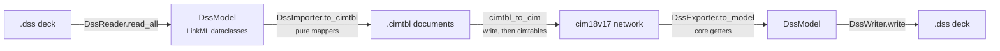

# Developer docs

How `cimhub_opendss` is built: the reader that parses a deck, the importer that maps it to `.cimtbl` text, the
exporter that reads CIM back through the core getters, and the writer that turns the result into a deck. These pages
are the map of the code. The per-class design record is in the two mapping specs, listed below.

## The two pipelines



Only the reader and the writer touch the deck files (plus `cimtbl_to_cim`, which writes the `.cimtbl` artifact so
that what a reviewer reads is exactly what was bound). Every stage returns something you can inspect. The exporter
returns the same `DssModel` type the reader does, so an exported model can be written, or imported again.

## Pages

| Page | Covers |
|---|---|
| [Architecture](architecture.md) | One row per module in `src/cimhub_opendss`, what it does and what it depends on; how the core ABCs are implemented. |
| [Reader and writer](reader-writer.md) | `DssReader` (commands, `like=`, continuation lines, aliases, errors), `DssModel`, `DssWriter` (command order, annotations). |
| [The importer](importer.md) | `DssImporter`, `MAPPING_ORDER`, the master, the topology walk, the mapper layout, one mapper end to end, adding one. |
| [The exporter](exporter.md) | `DssExporter`, `EXPORT_ORDER`, naming, options, `SLOTS`, one module end to end, adding one. |
| [The LinkML schema](schema.md) | The schema YAML, regenerating `opendss_schema.py`, the annotations the code reads, the schema reference. |
| [Testing](testing.md) | Atoms, the test types, decks and goldens, the engine comparison, environment variables and skips. |
| [Import mapping (.cimtbl)](../CIMTBL_MAPPING.md) | The approved design record of the import: for each DSS class, every property classified copied, mapped, structural, derived or untranscribed, the fail-fast rules and the expected differences. |
| [Export mapping](../EXPORT_MAPPING.md) | The approved design record of the export: for each CIM class, the DSS slots written, the rules, the slot tables generated from `SLOTS` and the expected differences. |

The mapping specs say what each mapper or exporter module must do; these pages say where the code is. Where a spec
and the code disagree, the code wins, and the spec should be corrected.

For what core provides, see the core site: the
[converter API](https://pnnl-cim-tools.github.io/CIMHub/core/developer/converter-api/), the
[`.cimtbl` import contract](https://pnnl-cim-tools.github.io/CIMHub/core/developer/cimtbl/), the
[canonical shapes](https://pnnl-cim-tools.github.io/CIMHub/core/developer/shapes/) and the
[test helpers](https://pnnl-cim-tools.github.io/CIMHub/core/developer/testing/).

## Rules that keep it simple

These are the invariants I1 to I9 from the repository's
[`CLAUDE.md`](https://github.com/PNNL-CIM-Tools/CIMHub/blob/develop/CLAUDE.md), as they show up in this package. A
change that breaks one needs a reason in the pull request.

| # | Rule | In this package |
|---|---|---|
| I1 | The `.cimtbl` artifact is the only input to CIM. | `DssImporter.to_cim` is the core `to_cim`: it writes the documents and loads the written files. `buscoords.cimtbl` is the one part made after binding (`bound_parts`), and it is written and loaded the same way. |
| I2 | Values are copied verbatim, in source units, with the unit in the column header. | A LineCode's `r1` goes out as `r (ohm/km)` with the deck's `units`. Named functions (`b_from_c`, `thevenin_from_short_circuit`) cover values CIM has no attribute for, and the artifact notes each as `derived`. Two spots still convert by hand: `vsource.mvasc_from_isc` divides by 1000, and `line.inline_code` converts the default C1 and C0 with `pint`. |
| I3 | Every field of a mapped native class is classified. | Each mapper has a `FIELDS` dict and its test calls `check_fields(FIELDS, NATIVE_CLASS)`. The exporter's mirror is `SLOTS`, checked by `check_slots`. |
| I4 | One artifact file per native table. | `MAPPING_ORDER` gives one document per DSS class (`linecode.cimtbl`, `line.cimtbl`, ...); the master imports them, catalogs first. |
| I5 | Spokes never construct CIM objects. | The mappers return `cimtables.document` rows and tables. Exporters read CIM and build only DSS dataclasses. Three mappers still build `cim.ReactivePower` or `cim.Voltage` values for unit math (`capacitor.py`, `generator.py`, `capcontrol.py`). |
| I6 | CIM 18 templates, never `*Info` catalogs. | A LineCode is a template `PerLengthImpedance` behind a `<template>_wc` `WireConfiguration`; an XfmrCode is a `TransformerTankConfiguration`; a LineSpacing is an `XYSpacing`. |
| I7 | Mappers are pure. | The `map_*` functions take records and return `Document`s. The reader, the writer and `cimtbl_to_cim` are the only code that touches files. |
| I8 | Fail fast. | An unknown property, an unmapped enum value, an unresolved reference, a property the mapping does not cover and ambiguous input all raise, naming the record. The reader raises `DssParseError` with file and line; mappers and exporters raise `ValueError`. |
| I9 | Upstream first. | Topology is `cimtopology.core`; every CIM read is a `cimhub_core.getters` function; naming and `SLOTS` come from `cimhub_core.names` and `cimhub_core.export_slots`. |

## Working on it

```bash
uv sync                                  # the ../CIM-* path sources are editable sibling checkouts
scripts/test-all.sh opendss              # this package's tests, in one pytest process
scripts/test-all.sh opendss -- -x -q     # arguments after -- go to pytest
CIMHUB_UPDATE_GOLDENS=1 scripts/test-all.sh opendss   # rewrite goldens; review the diff before committing
scripts/leak-gate.sh                     # must print "leak-gate: clean" before every commit
scripts/build-docs.sh opendss --serve    # preview this site at http://127.0.0.1:8000
```

Never run one pytest over the whole repository: cimtables sets the CIM profile and the model scope process-wide, so
each package needs its own interpreter. The whole-deck tests are skipped unless you pass `--roundtrip`; see
[Testing](testing.md).

`scripts/build-docs.sh opendss` first generates the schema reference (`docs/schema/`) from the LinkML schema, then
builds this site with `--strict`. Both are described on [The LinkML schema](schema.md).
