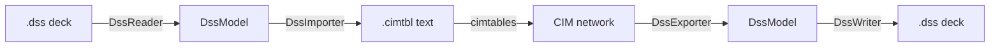

# User guide

You have an OpenDSS deck and want CIM, or a CIM model and want a deck. This guide runs both directions on the
IEEE 13-node deck that ships in the repository's tests.

-   __Getting started__

    ---

    [Installation](installation.md), then a [quick start](quickstart.ipynb) notebook that reads the deck, imports
    it to CIM, looks at the `.cimtbl` text and exports a deck.

-   __Converting__

    ---

    [Import](import.md) (deck to CIM): options, the artifact files, what raises.
    [Export](export.md) (CIM to deck): names, the circuit source, switch state, what raises.
    [Round trip](roundtrip.md): checking a converted deck against the original.

-   __What converts__

    ---

    [What converts](coverage.md) lists every DSS class the importer and exporter handle, and the ones they
    skip. The [conversion reference](../reference/index.md) gives each class's CIM mapping.

## The pipeline

`dss_to_cim` runs the middle row (model to CIM) and `cim_to_dss` the last two steps. The shared parts of the
pipeline, the `.cimtbl` contract and the getters that read CIM, are documented in
[CIMHub core](https://pnnl-cim-tools.github.io/CIMHub/core/).
