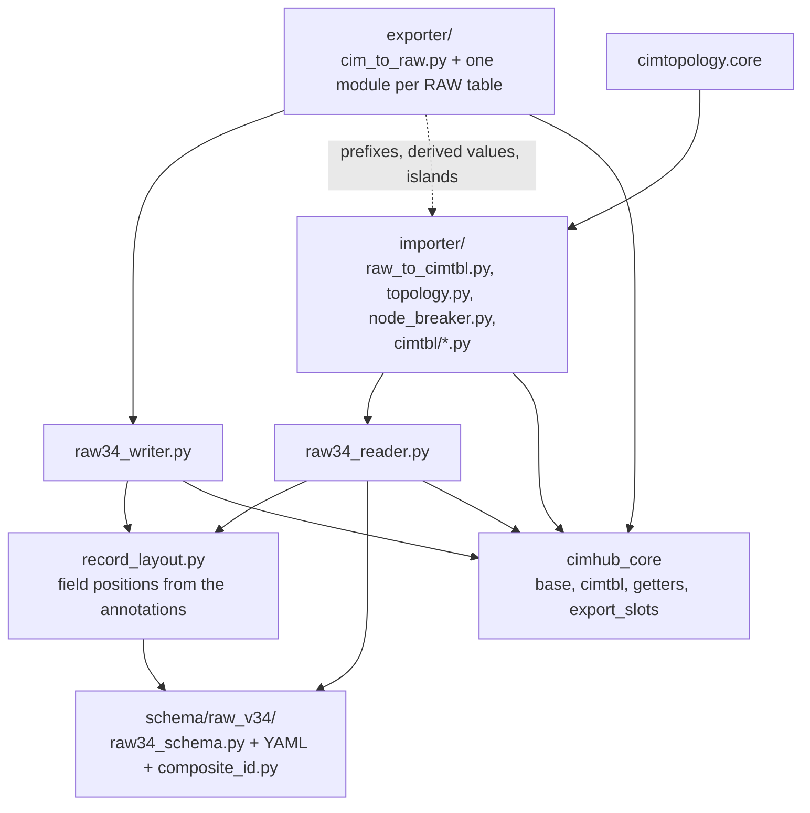

# Architecture

The package is `cimhub_raw`, under
[`cimhub_raw/src/cimhub_raw/`](https://github.com/PNNL-CIM-Tools/CIMHub/tree/develop/cimhub_raw/src/cimhub_raw).
It has four parts, one per core ABC, plus the schema they share. The hub and spoke layout, and what core holds, are
on the core site's [converter API](https://pnnl-cim-tools.github.io/CIMHub/core/developer/converter-api/) page.

The importer reads the `GraphModel` the reader builds. The exporter returns a `GraphModel` of the same record classes,
and `cim_to_raw` hands it to the writer. The exporter imports from the importer so that a rule is written once: the
mRID prefixes (`importer.cimtbl.fixed_shunt.PREFIX`), the derived functions and their inverses
(`derived.per_unit_from_mva` and `mva_from_per_unit`), the rating-set type names, and `topology.islands` for the area
trace. The importer never imports from the exporter.

## How the four ABCs are implemented

| Core class | Here | Entry point |
|---|---|---|
| `FormatReader` | `Raw34Reader(source)` binds a `.raw` path; `read_all()` parses the file once and returns a `GraphModel`. | `Raw34Reader(path).read_all()` |
| `FormatWriter` | `Raw34Writer`: `write(model, destination)` writes the case file; `lines(model)` returns its lines; `serialize(obj)` returns one record as RAW text. | `Raw34Writer().write(model, "out.raw")` |
| `CimtblImporter` | `RawImporter(name, *, authority)` implements `to_cimtbl`; `to_cim` and `bound_parts` are core's (no bound parts). `model_cls` is `BusBranchModel`. | `raw_to_cim(model, name=...)` |
| `FormatExporter` | `RawExporter().to_model(network)` returns a `GraphModel` of RAW records. | `cim_to_raw(network, "out.raw")` |

`raw_to_cim` and `cim_to_raw` build the object and make the one call; `cim_to_raw` then writes the model with
`Raw34Writer`. `RawImporter.to_cim` takes a parsed model and never a path; `cim_to_raw` takes a destination because
writing is its job. The package `__init__.py` is empty, so import from the modules named below. The class-level
contracts are in the core
[converter API](https://pnnl-cim-tools.github.io/CIMHub/core/developer/converter-api/).

## Why a BusBranchModel

A RAW case is a bus-branch model: every device names the buses at its ends, and a bus is a number. The importer
therefore sets `RawImporter.model_cls = BusBranchModel`, and each RAW bus becomes a `TopologicalNode` (mRID the bare bus
number) with a `BusbarSection`; every device terminal is on a `TopologicalNode`. The exporter relies on the same
shape: a bus number is `TopologicalNode.busNumber`, and a device's end buses are its terminals' nodes in
`sequenceNumber` order (`identity.terminal_buses`).

Substations are not in RAW's bus section, so the importer synthesizes them: buses joined by equipment that sits
inside a substation (switches, zero-impedance branches, series capacitors, transformers) form one `Substation`
(`importer/topology.py`). The substation is the equipment container of everything at its buses.

A SUBSTATION block (RAW's node-breaker data) adds detail inside a bus. Its nodes become `ConnectivityNode`s, each
inside its bus's `TopologicalNode`; its switching devices become `Switch`, `Breaker` or `Disconnector`s between nodes;
and its equipment terminal records move each named `Terminal` from the bus to its node with `Update` rows
(`equipment_terminal.cimtbl`). The model is still a `BusBranchModel`: the bus stays the unit of the network, and the
nodes sit inside it. A block's buses always form one substation, named `sub_s<IS>`.

## Module map

### Top level

| Module | What it does | Depends on |
|---|---|---|
| `raw34_reader.py` | `Raw34Reader`, `Raw34ParseError`, `SECTIONS`, `tokenize`: a `.raw` file to a `GraphModel`. | `record_layout`, `composite_id`, `schema`, `cimhub_core` (`GraphModel`, `base`) |
| `raw34_writer.py` | `Raw34Writer`, `format_field`, `format_line`, `format_record`: a `GraphModel` to a `.raw` file. | `raw34_reader` (`SECTIONS` and the phase-2 set), `record_layout`, `schema` |
| `record_layout.py` | `Slot`, `record_lines`, `line_count`, `terminal_slots`: the positional layout of each record, from the schema annotations, shared by reader and writer. | `schema`, `cimhub_core.serialization` |
| `schema/raw_v34/raw34_schema.py` | The generated dataclasses, one per RAW record type. Never edited by hand. | `linkml_runtime` |
| `schema/raw_v34/*.yaml` | The LinkML YAML the module is generated from, and the annotations the code reads. | |
| `schema/raw_v34/composite_id.py` | `assign_composite_id`, `KEY_FIELDS`: the natural key of each record type, set as `record.ID`. | `schema`, `cimhub_core.serialization` |

### Importer

| Module | What it does | Depends on |
|---|---|---|
| `importer/raw_to_cimtbl.py` | `RawImporter`, `raw_to_cim`, `MAPPING_ORDER`, `Site`, `map_master`: the orchestrator. | every mapper, `topology`, `node_breaker`, `cimhub_core` |
| `importer/topology.py` | `substation_groups`, `SubstationGroup`, `untraced_area_buses`, `islands`: the substations of a bus-branch case. | `cimtopology.core`, `schema` |
| `importer/node_breaker.py` | `NodeBreaker`, `node_mrid`, `node_busbar_mrid`: which SUBSTATION block each bus is in, each block's nodes, and the terminal a control regulating a node names. | `schema`, `importer/cimtbl/bus` |

Each mapper in `importer/cimtbl/` has a `NATIVE_CLASS`, a `FIELDS` classification and a `map_<table>(native, ...)`
function that returns one `Document`. Shared helpers come first, then the mappers.

| Module | RAW table | Output file | Also depends on |
|---|---|---|---|
| `records.py` | not a table: `raw_defaults`, `fill_keyed_defaults`, `listed_off_default` | | `cimhub_core.cimtbl` |
| `derived.py` | not a table: the named, tested derived values and their inverses (`kv_from_per_unit`, `ka_from_rating`, `per_unit_from_mva`, `transformer_ohms`, `ratio_tap`, `zip_mix`, ...) | | `cimprofiles.units` |
| `ratings.py` | not a table: the twelve rating-set `OperationalLimitType`s and `RatingRows`, the limit rows of a rated device | `master` and the device documents | `derived` |
| `tie_flow.py` | not a table: the `TieFlow` pairs of a device whose ends are in two areas | | `area_interchange` |
| `dc_topology.py` | not a table: the `DCLine`, `DCTopologicalNode`s and converter DC terminals of a DC line | | |
| `phase2.py` | not a table: `not_mapped_yet`, the shared body of the stubs | | |
| `case_identification.py` | Case identification and system-wide data (`case_values`, `case_record`) | the master | |
| `zone.py` | Zone | `zone` | |
| `area_interchange.py` | Area interchange | `area_interchange` | `interarea_transfer`, `derived` |
| `interarea_transfer.py` | Inter-area transfer: no artifact, listed on the `ControlArea` comment | | |
| `owner.py` | Owner: no artifact (a CIM 18 gap) | | |
| `bus.py` | Bus | `bus` | `topology`, `zone`, `derived` |
| `substation.py` | SUBSTATION nodes and switching devices (`NODE_FIELDS`, `DEVICE_FIELDS`) | `substation` | `bus`, `switch`, `ratings`, `node_breaker` |
| `branch.py` | Branch | `branch` | `ratings`, `tie_flow`, `area_interchange` |
| `switch.py` | System switching device | `switch` | `ratings`, `tie_flow` |
| `multi_section_line.py` | Multi-section line | `multi_section_line` | `branch`, `zone` |
| `load.py` | Load | `load` | `area_interchange`, `derived` |
| `fixed_shunt.py` | Fixed shunt | `fixed_shunt` | `derived` |
| `generator.py` | Generator | `generator` | `area_interchange`, `derived` |
| `impedance_correction.py` | Transformer impedance correction (`NATIVE_CLASS`, `POINT_CLASS`) | `impedance_correction` | `derived` |
| `transformer.py` | Transformer | `transformer` | `impedance_correction`, `ratings`, `tie_flow`, `derived` |
| `two_terminal_dc.py` | Two-terminal DC line | `two_terminal_dc` | `area_interchange`, `dc_topology`, `derived`, `tie_flow` |
| `vsc_dc.py` | VSC DC line | `vsc_dc` | `area_interchange`, `dc_topology`, `derived`, `ratings`, `tie_flow`, `node_breaker` |
| `facts_device.py` | FACTS device (a shunt-only device) | `facts_device` | `node_breaker`, `derived` |
| `switched_shunt.py` | Switched shunt | `switched_shunt` | `generator`, `facts_device`, `derived` |
| `equipment_terminal.py` | SUBSTATION equipment terminals | `equipment_terminal` | every equipment mapper's mRID prefix, `node_breaker` |
| `multi_terminal_dc.py`, `gne_device.py`, `induction_machine.py` | the three phase-2 stubs: an empty document, or `NotImplementedError` when the case has records | none | `phase2` |

### Exporter

| Module | What it does | Depends on |
|---|---|---|
| `exporter/cim_to_raw.py` | `RawExporter`, `cim_to_raw`, `EXPORT_ORDER`, `ExportContext`, `export_context`, `export_tables`: runs each module over the network, assigns the composite IDs and refuses equipment no module exports. | every module below, `Raw34Writer` |
| `exporter/identity.py` | `bus_numbers`, `keyed_numbers`, `terminal_buses`, `keyed_ids`, `raw_name`: bus, zone and area numbers, device IDs and NAMEs from the mRIDs the importer wrote. | `cimhub_core.getters` |
| `exporter/area_trace.py` | `trace_areas`, `metered_terminal`: each bus's AREA, traced from generating units and tie flows. | `importer/topology` (`islands`) |
| `exporter/ratings.py` | `device_limits`, `device_ratings`, `ratings_in_current`, `rating_set_number`: RATE1..RATE12 and the case's rating units. | `getters.limits_by_type`, `getters.base_voltage`, `importer/cimtbl/ratings`, `derived` |
| `exporter/shunt_admittance.py` | `bus_base_admittance`: a shunt's g and b in pu on its bus's base. | `getters.shunt` |

The export modules proper. Each has `NATIVE_CLASS`, `CIM_CLASSES`, `SLOTS` and `export(context)`:

| Module | CIM class | RAW record |
|---|---|---|
| `case_identification.py` | `BasePower`, `BaseFrequency`, the rating-set types (`CIM_CLASSES` is empty) | Case identification, Rating |
| `zone.py` | `SubGeographicalRegion` (empty) | Zone |
| `area_interchange.py` | `ControlArea` (empty) | Area interchange |
| `bus.py` | `BusbarSection` (each numbered `TopologicalNode`) | Bus |
| `branch.py` | `ACLineSegment`, `SeriesCompensator` (with their line shunts and ratings) | Branch |
| `switch.py` | `Switch`, `Breaker`, `Disconnector` | System switching device |
| `multi_section_line.py` | `Line` (empty: a container) | Multi-section line |
| `load.py` | `EnergyConsumer`, `ConformLoad`, `NonConformLoad` | Load |
| `fixed_shunt.py` | `LinearShuntCompensator` with no control | Fixed shunt |
| `switched_shunt.py` | `LinearShuntCompensator`s under one `RegulatingControl` | Switched shunt |
| `generator.py` | `SynchronousMachine`, `PowerElectronicsConnection` (with the step-up folded back) | Generator |
| `transformer.py` | `PowerTransformer` | Transformer |
| `impedance_correction.py` | `ImpedanceTapChangerTable` (empty) | Impedance correction |

## Boundaries

- No module in `importer/` or `exporter/` opens a file. `raw_to_cim` writes the artifact only through core's
  `to_cim`, and `cim_to_raw` writes only through `Raw34Writer`.
- Field positions, widths and quoting live in the schema annotations, read through `record_layout`. Neither the
  reader nor the writer hard-codes a column.
- A record's key is `composite_id.assign_composite_id`, called by the reader when it adds a record and by
  `export_tables` when it adds an exported one, so the key that seeds an mRID on import is the key an exported record
  has.
- The importer fills RAW's defaults and lists them in a `defaulted:` comment; the reader does not default anything
  (the one exception is a blank key field, see [Reader and writer](reader-writer.md)).
