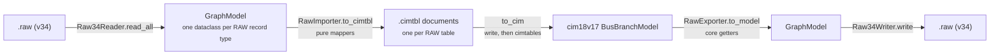

# Developer docs

How `cimhub_raw` is built: the reader that parses a `.raw` file, the importer that maps it to `.cimtbl` text, the
exporter that reads CIM back through the core getters, and the writer that turns the result into a `.raw` file. These
pages are the map of the code. The per-table design record is in the two mapping specs, listed below.

## The two pipelines



Only the reader and the writer touch the case file (plus the core `to_cim`, which writes the `.cimtbl` artifact so
that what a reviewer reads is exactly what was bound). Every stage returns something you can inspect. The exporter
returns the same kind of `GraphModel` the reader does, so an exported model can be written, or imported again.

The importer maps buses, branches, switches, multi-section lines, transformers and impedance correction tables, loads,
shunts, generators, areas, zones, node-breaker substations, two-terminal and VSC DC lines and FACTS devices. The
exporter writes back everything in that list except the node-breaker substations, the DC lines and the FACTS devices;
it raises when the network holds conducting equipment it has no module for. See [Architecture](architecture.md) for the
module list and the user guide's [What converts](../guide/coverage.md) for the table a user sees.

## Pages

| Page | Covers |
|---|---|
| [Architecture](architecture.md) | One row per module in `src/cimhub_raw`, what it does and what it depends on; how the core ABCs are implemented; why the model is a `BusBranchModel`. |
| [Reader and writer](reader-writer.md) | `Raw34Reader` (sections, tokens, the `Q` record, multi-line records, defaults, composite IDs, errors), the `GraphModel`, `Raw34Writer` (field formats, section order, the impedance-correction special case). |
| [The importer](importer.md) | `RawImporter`, `Site`, `MAPPING_ORDER`, the master, the topology and node-breaker modules, the mapper layout, one mapper end to end, adding one. |
| [The exporter](exporter.md) | `RawExporter`, `EXPORT_ORDER`, `ExportContext`, identity, the area trace, ratings, `SLOTS`, one module end to end, adding one. |
| [The LinkML schema](schema.md) | The YAML in `schema/raw_v34/`, regenerating `raw34_schema.py`, the annotations the code reads, the schema reference. |
| [Testing](testing.md) | The four test files, the atoms and cases, the goldens, environment variables and skips. |
| [Import mapping (.cimtbl)](../CIMTBL_MAPPING.md) | The approved design record of the import: for each RAW table, every field classified copied, mapped, structural, derived or untranscribed, the fail-fast rules, the CIM 18 gaps and the expected differences. |
| [Export mapping](../EXPORT_MAPPING.md) | The approved design record of the export: sections E0 to E4, the rules for each table, the slot tables generated from `SLOTS` and the expected differences. |

The mapping specs say what each mapper or exporter module must do; these pages say where the code is. Where a spec
and the code disagree, the code wins, and the spec should be corrected. The plan behind both is
[`.development/RAW_REWRITE_PLAN.md`](https://github.com/PNNL-CIM-Tools/CIMHub/blob/develop/.development/RAW_REWRITE_PLAN.md);
the decision IDs the code's comments quote (`RAW-9`, `R4b-6`, `E1-2`, `P2a`) are defined in the plan and the specs.

For what core provides, see the core site: the
[converter API](https://pnnl-cim-tools.github.io/CIMHub/core/developer/converter-api/), the
[`.cimtbl` import contract](https://pnnl-cim-tools.github.io/CIMHub/core/developer/cimtbl/), the
[canonical shapes](https://pnnl-cim-tools.github.io/CIMHub/core/developer/shapes/), the
[getters](https://pnnl-cim-tools.github.io/CIMHub/core/guide/getters/) and the
[test helpers](https://pnnl-cim-tools.github.io/CIMHub/core/developer/testing/).

## Rules that keep it simple

These are the invariants I1 to I9 from the repository's
[`CLAUDE.md`](https://github.com/PNNL-CIM-Tools/CIMHub/blob/develop/CLAUDE.md), as they show up in this package. A
change that breaks one needs a reason in the pull request.

| # | Rule | In this package |
|---|---|---|
| I1 | The `.cimtbl` artifact is the only input to CIM. | `RawImporter.to_cim` is core's: it writes the documents and loads the written files. There are no `bound_parts`; every part is mapped from the RAW records alone. `equipment_terminal.cimtbl` is built from the other documents' rows (`written_equipment`), never from CIM objects. |
| I2 | Values are copied verbatim, in source units, with the unit in the column header. | A RAW value goes into its column as read (`cell(value)`), with its unit in the header: `Column("basePower", "MVA")`, `Column("nominalVoltage", "kV")`. Per unit values on the system base are written as `(pu system)` and converted by cimtables. Where CIM has no attribute for the source quantity, a named function in `importer/cimtbl/derived.py` computes it (`kv_from_per_unit`, `ka_from_rating`, `per_unit_from_mva`), and the field is classified `derived`. |
| I3 | Every field of a mapped native class is classified. | Each mapper module has a `FIELDS` dict, and `test_classification_is_complete` calls `check_fields(FIELDS, NATIVE_CLASS)`. The exporter's mirror is `SLOTS`, checked by `check_slots` in `test_slots_are_complete`. |
| I4 | One artifact file per native table. | `MAPPING_ORDER` gives one document per RAW table (`bus.cimtbl`, `branch.cimtbl`, ...); the master imports them, with the zones, areas and buses first. `equipment_terminal.cimtbl` is written last. The SUBSTATION section's node and switching device records share `substation.cimtbl`. |
| I5 | Spokes never construct CIM objects. | The mappers return `cimtables.document` rows and tables. The exporter reads CIM and builds only RAW record dataclasses. |
| I6 | CIM 18 templates, never `*Info` catalogs. | RAW has no catalogs: every transformer, line and shunt carries its own values, so no catalog or template class is written. The twelve rating sets are `OperationalLimitType`s, and a device's ratings are an `OperationalLimitSet`. |
| I7 | Mappers are pure. | The `map_*` functions take the `GraphModel` and return `Document`s. The reader, the writer and core's `to_cim` are the only code that touches files. |
| I8 | Fail fast. | An unknown field, an unmapped enum value, an unresolved reference, a table with no mapping yet and ambiguous input raise, naming the record. The reader raises `Raw34ParseError` with file and line; mappers and exporters raise `ValueError` or `NotImplementedError`. IDs are quoted, never sanitized. The exporter has two documented fallbacks, both logged with a count (`keyed_numbers`, `keyed_ids`). |
| I9 | Upstream first. | Topology is `cimtopology.core` (`importer/topology.py` builds a `Network`; the exporter's area trace reuses its `islands`); every CIM read is a `cimhub_core.getters` function or `cimtables.graph_write.get_qty`; `Slot` and `check_slots` are `cimhub_core.export_slots`. |

## Working on it

```bash
uv sync                                  # the ../CIM-* path sources are editable sibling checkouts
scripts/test-all.sh raw                  # this package's tests, in one pytest process
scripts/test-all.sh raw -- -x -q         # arguments after -- go to pytest
CIMHUB_UPDATE_GOLDENS=1 scripts/test-all.sh raw   # rewrite goldens; review the diff before committing
scripts/leak-gate.sh                     # must print "clean" before every commit
scripts/build-docs.sh raw --serve        # preview this site at http://127.0.0.1:8000
scripts/gen-schema.sh raw                # regenerate schema/raw_v34/raw34_schema.py after a schema YAML change
```

Never run one pytest over the whole repository: cimtables sets the CIM profile and the model scope process-wide, so
each package needs its own interpreter. Nothing in this package skips; see [Testing](testing.md).

`scripts/build-docs.sh raw` first generates the schema reference (`docs/schema/`) from the LinkML schema, then builds
this site with `--strict`. Both are described on [The LinkML schema](schema.md).
