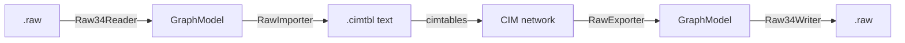

# User guide

You have a PSS/E RAW v34 case and want CIM, or a CIM model and want a `.raw`. This guide runs both directions on the
IEEE 14-bus case that ships in the repository's tests.

-   __Getting started__

    ---

    [Installation](installation.md), then a [quick start](quickstart.ipynb) notebook that reads the case, imports it
    to CIM, looks at the `.cimtbl` text and exports a `.raw`.

-   __Converting__

    ---

    [Import](import.md) (`.raw` to CIM): reader and importer options, the artifact files, the system base, what raises.
    [Export](export.md) (CIM to `.raw`): bus numbers and IDs, the AREA trace, ratings, what raises.
    [Round trip](roundtrip.md): what comes back unchanged, what changes and the checks that cover it.

-   __What converts__

    ---

    [What converts](coverage.md) lists every RAW table the importer and exporter handle, and the ones they skip.
    The [conversion reference](../reference/index.md) gives each table's CIM mapping.

## The pipeline

`raw_to_cim` runs the middle row (records to CIM) and `cim_to_raw` the last two steps. The shared parts of the
pipeline, the `.cimtbl` contract and the getters that read CIM, are documented in
[CIMHub core](https://pnnl-cim-tools.github.io/CIMHub/core/).
