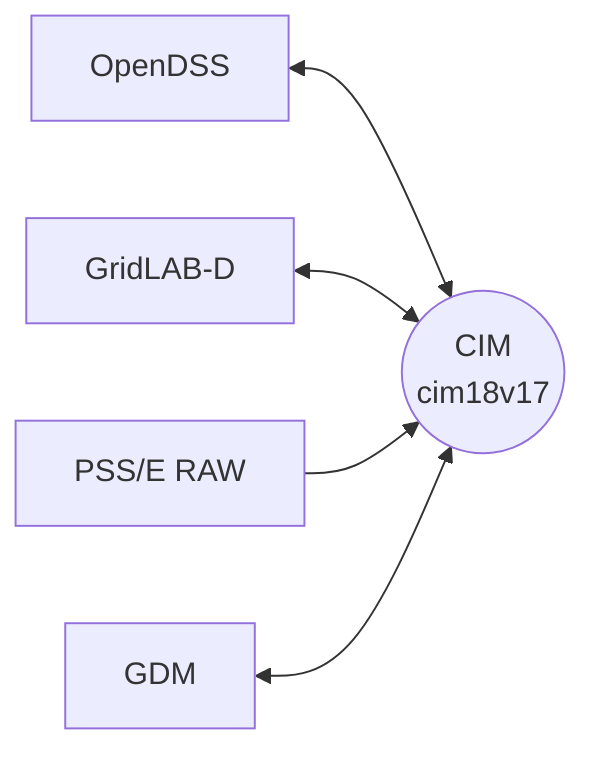

<div class="ct-hero" markdown>

# Any power-system model, <span class="ct-accent">through CIM</span>

<p class="ct-lede">CIMHub converts native power-system formats to and from the IEC Common Information Model
(CIM 18, profile <code>cim18v17</code>). Each format is its own package, a spoke; CIM is the hub, so any two formats
convert through it. Every package has its own documentation.</p>

</div>

<div class="grid cards" markdown>

-   :material-hub:{ .lg .middle } __cimhub-core__

    ---

    The shared layer: the export getters that read CIM in the unit you ask for, the `.cimtbl` import contract,
    the canonical table shapes and the test harness. Start here to write a converter or read CIM from Python.

    [:octicons-arrow-right-24: Core docs](https://pnnl-cim-tools.github.io/CIMHub/core/)

-   :material-transmission-tower:{ .lg .middle } __cimhub-opendss__

    ---

    OpenDSS decks (`.dss`) to and from CIM, geometry kept as geometry.

    [:octicons-arrow-right-24: OpenDSS docs](https://pnnl-cim-tools.github.io/CIMHub/opendss/)

-   :material-home-lightning-bolt:{ .lg .middle } __cimhub-gridlabd__

    ---

    GridLAB-D models (`.glm`) to and from CIM, players and schedules included.

    [:octicons-arrow-right-24: GridLAB-D docs](https://pnnl-cim-tools.github.io/CIMHub/gridlabd/)

-   :material-transmission-tower-export:{ .lg .middle } __cimhub-raw__

    ---

    PSS/E RAW v34 transmission cases to CIM, bus-branch.

    [:octicons-arrow-right-24: Source and README](https://github.com/PNNL-CIM-Tools/CIMHub/tree/develop/cimhub_raw)

-   :material-graph:{ .lg .middle } __cimhub-gdm__

    ---

    grid-data-models `DistributionSystem` objects to and from CIM, time series included.

    [:octicons-arrow-right-24: Source and README](https://github.com/PNNL-CIM-Tools/CIMHub/tree/develop/cimhub_gdm)

</div>

## How a conversion works



- **Import.** A spoke reads its native file, maps every record to `.cimtbl` text (values verbatim, the source unit
  on each column header), and [cimtables](https://pnnl-cim-tools.github.io/CIM-Tables/) builds the CIM model from
  that text. The `.cimtbl` files are a reviewable record of exactly what was mapped.
- **Export.** A spoke reads the CIM model through the core getters, which return plain numbers in the unit the
  caller asks for, and writes native records.

```bash
pip install --pre cimhub-opendss      # each spoke installs cimhub-core
```
